# Polyglot Codebase Knowledge Graph

> Generated offline by **readmenator**. 31 files, 423 symbols, 7 imports. Supports C, C++, Python, Go, Rust, JS/TS, Java, C#, Shell, PHP, Dart, GDScript, Nim, ASM, Ruby, Swift, Kotlin, Scala, Lua, Elixir.
> No LLMs. No tokens. Pure static analysis. See more [here](https://github.com/grisuno/ReadMenator)

**Start here:** Statistics Dashboard for scope, God Nodes for blast radius, Architecture Reference for per-file API. Agents: prefer `readmenator-agent/INDEX.md` + `SYMBOLS.md`.

**Wiki:** prefer `readmenator-wiki/index.md` for progressive disclosure: one synthesis page per community, `connections.json` with EXTRACTED vs INFERRED confidence, `queries.md` log, `REPORT.md` audit.

**Confidence:** EXTRACTED = parsed from source, INFERRED = heuristic bridge, AMBIGUOUS = reported, never hidden. See `readmenator-wiki/REPORT.md`.

**Total Files Parsed:** 31 | **Total Symbols Extracted:** 423 | **Total Imports:** 7

<!-- ranking_model: v1.0 | weights: {ppr:0.45,auth:0.2,test:0.15,doc:0.1,fresh:0.1} | alpha:0.85 | commit:72eaf15 | date:2026-07-18 -->


## Table of Contents

1. [Statistics Dashboard](#statistics-dashboard)
2. [Architectural Layers](#architectural-layers)
3. [Ranked Context](#ranked-context)
4. [God Nodes](#god-nodes)
5. [Suggested Questions](#suggested-questions)
6. [Force-Graph Explorer](#force-graph-explorer)
7. [Corpus Analytics](#corpus-analytics)
8. [Hotspot Analysis](#hotspot-analysis)
9. [Change Impact Analysis](#change-impact-analysis)
10. [Suggested Linting Rules](#suggested-linting-rules)
11. [Concept Graph](#concept-graph)
12. [Orphans](#orphans)
13. [Query Recipes](#query-recipes)
14. [Structural Knowledge Map](#structural-knowledge-map)
15. [UML Class Diagram](#uml-class-diagram)
16. [Code Property Graph](#code-property-graph)
17. [Architecture Reference](#architecture-reference)
    - [C (17 files)](#c-17-files)
    - [PY (1 files)](#py-1-files)
    - [S (10 files)](#s-10-files)
    - [SH (3 files)](#sh-3-files)

---

## Statistics Dashboard

| Metric | Value |
|--------|-------|
| Total Files | 31 |
| Total Symbols | 423 |
| Total Imports | 7 |
| Call Edges | 0 |
| Inheritance Edges | 0 |
| Languages | 4 |
| Avg Symbols/File | 13.6 |
| Avg Imports/File | 0.2 |

### Top Files by Import Count (Fan-Out)

| File | Imports | Symbols | Language |
|------|---------|---------|----------|
| `ld.c` | 3 | 349 | c |
| `dynlib_host.c` | 2 | 0 | c |
| `stdint.c` | 2 | 6 | c |

---

## Architectural Layers

Auto-detected from path patterns, naming conventions, and imported frameworks.

| Layer | Files |
|-------|-------|
| testing | 28 |
| utility | 3 |

### utility

- `app.py` (py, 0 symbols)
- `install.sh` (sh, 0 symbols)
- `ld.c` (c, 349 symbols)

### testing

- `argv.c` (c, 2 symbols)
- `argv.s` (s, 2 symbols)
- `asm.c` (c, 2 symbols)
- `chain.c` (c, 2 symbols)
- `dynlib.c` (c, 2 symbols)
- `dynlib_host.c` (c, 0 symbols)
- `dynuse.c` (c, 3 symbols)
- `fib.s` (s, 3 symbols)
- `fib2.s` (s, 3 symbols)
- `fib3.s` (s, 3 symbols)
- `fmt.c` (c, 2 symbols)
- `fnptr.c` (c, 7 symbols)
- `globals.c` (c, 3 symbols)
- `hello.c` (c, 1 symbols)
- `loop.s` (s, 2 symbols)
- *... and 13 more*

---

## Ranked Context

Files ranked by composite score for the current query context. The ranking combines Personalized PageRank (query relevance), global authority, test coverage, documentation coverage, and code freshness. Model: v1.0.

| Rank | File | Composite | PPR | Authority | Test | Doc |
|------|------|-----------|-----|-----------|------|-----|
| 1 | `app.py` | 0.1000 | 0.0000 | 0.0000 | 0.00 | 1.00 |
| 2 | `dynlib_host.c` | 0.1000 | 0.0000 | 0.0000 | 0.00 | 1.00 |
| 3 | `mutate.sh` | 0.1000 | 0.0000 | 0.0000 | 0.00 | 1.00 |
| 4 | `run_tests.sh` | 0.0909 | 0.0000 | 0.0000 | 0.00 | 0.91 |
| 5 | `ld.c` | 0.0057 | 0.0000 | 0.0000 | 0.00 | 0.06 |
| 6 | `install.sh` | 0.0000 | 0.0000 | 0.0000 | 0.00 | 0.00 |
| 7 | `argv.c` | 0.0000 | 0.0000 | 0.0000 | 0.00 | 0.00 |
| 8 | `argv.s` | 0.0000 | 0.0000 | 0.0000 | 0.00 | 0.00 |
| 9 | `asm.c` | 0.0000 | 0.0000 | 0.0000 | 0.00 | 0.00 |
| 10 | `chain.c` | 0.0000 | 0.0000 | 0.0000 | 0.00 | 0.00 |

---

## God Nodes

Most architecturally central files ranked by combined import/export degree and symbol richness.

| File | Score | Connections | PageRank |
|------|-------|-------------|----------|
| `ld.c` | 34.9 | | 0.0000 |
| `run_tests.sh` | 1.1 | | 0.0000 |
| `fnptr.c` | 0.7 | | 0.0000 |
| `stdint.c` | 0.6 | | 0.0000 |
| `dynuse.c` | 0.3 | | 0.0000 |
| `fib.s` | 0.3 | | 0.0000 |
| `fib2.s` | 0.3 | | 0.0000 |
| `fib3.s` | 0.3 | | 0.0000 |
| `globals.c` | 0.3 | | 0.0000 |
| `usestr.c` | 0.3 | | 0.0000 |

---

## Suggested Questions

Auto-generated exploration prompts based on graph structure:

- What does ld.c depend on, and what depends on it? (0 connections)
- What does run_tests.sh depend on, and what depends on it? (0 connections)
- What does fnptr.c depend on, and what depends on it? (0 connections)
- What is Sym in ld.c and how is it used?
- What is the overall architecture of this codebase?

---

## Force-Graph Explorer

Heterogeneous explorer payload (files, communities, layers, externals) rendered with force-graph physics, stable family colors, log2 node sizing, and convex-hull community overlays. Open `readmenator-maps/graph-force.html` (linked from the maps gallery) or run `explorer`.

- Nodes: 37 (external: 4, file: 31, layer: 2)
- Edges: 37

---

## Corpus Analytics

Attribution funnel and distributions for the explorer dashboard.

- Files: 31 | With symbols: 27 | Attributed: 0 | God nodes: 10 | Symbols: 423

- Layer `testing`: 28 files
- Layer `utility`: 3 files

- Language `c`: 17 files
- Language `s`: 10 files
- Language `sh`: 3 files
- Language `py`: 1 files

---

## Hotspot Analysis

Files ranked by combined complexity (symbol count) and centrality (connection count). High-scoring files are architecturally critical and may need refactoring attention.

| File | Complexity | Centrality | Combined | Symbols | Connections |
|------|-----------|------------|----------|---------|-------------|
| `app.py` | 0.000 | 0.000 | 0.000 | 0 | 0 |
| `dynlib_host.c` | 0.000 | 0.667 | 0.400 | 0 | 2 |
| `mutate.sh` | 0.000 | 0.000 | 0.000 | 0 | 0 |
| `run_tests.sh` | 0.032 | 0.000 | 0.013 | 11 | 0 |
| `ld.c` | 1.000 | 1.000 | 1.000 | 349 | 3 |
| `install.sh` | 0.000 | 0.000 | 0.000 | 0 | 0 |
| `argv.c` | 0.006 | 0.000 | 0.002 | 2 | 0 |
| `argv.s` | 0.006 | 0.000 | 0.002 | 2 | 0 |
| `asm.c` | 0.006 | 0.000 | 0.002 | 2 | 0 |
| `chain.c` | 0.006 | 0.000 | 0.002 | 2 | 0 |
| `stdint.c` | 0.017 | 0.667 | 0.407 | 6 | 2 |
| `fnptr.c` | 0.020 | 0.000 | 0.008 | 7 | 0 |
| `dynuse.c` | 0.009 | 0.000 | 0.003 | 3 | 0 |
| `fib.s` | 0.009 | 0.000 | 0.003 | 3 | 0 |
| `fib2.s` | 0.009 | 0.000 | 0.003 | 3 | 0 |

---

## Concept Graph

Semantic second-brain layer: nouns are concept nodes, verbs are edges. Each noun maps atomically to a file set (EXTRACTED); each verb aggregates structural imports, calls, and inherits into consumes, invokes, extends, depends_on, or bridges (INFERRED).

**50 concepts, 0 relations.**

| Concept | Files | Mentions |
|---------|-------|----------|
| `start` | 11 | 13 |
| `printf` | 6 | 6 |
| `run` | 5 | 24 |
| `fib` | 4 | 6 |
| `name` | 3 | 19 |
| `shared` | 3 | 19 |
| `write` | 3 | 16 |
| `every` | 3 | 9 |
| `host` | 3 | 8 |
| `chain` | 3 | 7 |
| `dynlib` | 3 | 7 |
| `fmt` | 3 | 6 |
| `against` | 3 | 5 |
| `file` | 3 | 5 |
| `program` | 3 | 5 |
| `dlopen` | 3 | 4 |
| `dynadd` | 3 | 3 |
| `dynlen` | 3 | 3 |
| `elf` | 2 | 127 |
| `cvm` | 2 | 25 |
| `import` | 2 | 16 |
| `rela` | 2 | 14 |
| `exit` | 2 | 13 |
| `dynamic` | 2 | 11 |
| `library` | 2 | 11 |
| `stub` | 2 | 11 |
| `plt` | 2 | 10 |
| `soname` | 2 | 9 |
| `table` | 2 | 9 |
| `through` | 2 | 9 |

### Dialectic Prompts

- Thesis: `against` centralizes 3 files; Antithesis: `build` pulls 2 files with 2 shared (Jaccard 0.67); Synthesis: should they merge, split by layer, or keep `bridges` explicit?
- Thesis: `against` centralizes 3 files; Antithesis: `built` pulls 2 files with 2 shared (Jaccard 0.67); Synthesis: should they merge, split by layer, or keep `bridges` explicit?
- Thesis: `against` centralizes 3 files; Antithesis: `call` pulls 2 files with 2 shared (Jaccard 0.67); Synthesis: should they merge, split by layer, or keep `bridges` explicit?
- Thesis: `against` centralizes 3 files; Antithesis: `calls` pulls 2 files with 2 shared (Jaccard 0.67); Synthesis: should they merge, split by layer, or keep `bridges` explicit?
- Thesis: `against` centralizes 3 files; Antithesis: `chain` pulls 3 files with 2 shared (Jaccard 0.50); Synthesis: should they merge, split by layer, or keep `bridges` explicit?
- Thesis: `against` centralizes 3 files; Antithesis: `code` pulls 2 files with 2 shared (Jaccard 0.67); Synthesis: should they merge, split by layer, or keep `bridges` explicit?
- Thesis: `against` centralizes 3 files; Antithesis: `cvm` pulls 2 files with 2 shared (Jaccard 0.67); Synthesis: should they merge, split by layer, or keep `bridges` explicit?
- Thesis: `against` centralizes 3 files; Antithesis: `dlopen` pulls 3 files with 2 shared (Jaccard 0.50); Synthesis: should they merge, split by layer, or keep `bridges` explicit?
- Thesis: `against` centralizes 3 files; Antithesis: `dynamic` pulls 2 files with 2 shared (Jaccard 0.67); Synthesis: should they merge, split by layer, or keep `bridges` explicit?
- Thesis: `against` centralizes 3 files; Antithesis: `elf` pulls 2 files with 2 shared (Jaccard 0.67); Synthesis: should they merge, split by layer, or keep `bridges` explicit?

---

## Change Impact Analysis

Files sorted by how many other files would be affected if they changed. High-impact files should be changed with caution.

| File | Direct Dependents | Transitive Dependents | Total Impact |
|------|------------------|----------------------|--------------|
| `app.py` | 0 | 0 | 0 |
| `install.sh` | 0 | 0 | 0 |
| `ld.c` | 0 | 0 | 0 |
| `argv.c` | 0 | 0 | 0 |
| `argv.s` | 0 | 0 | 0 |
| `asm.c` | 0 | 0 | 0 |
| `chain.c` | 0 | 0 | 0 |
| `dynlib.c` | 0 | 0 | 0 |
| `dynlib_host.c` | 0 | 0 | 0 |
| `dynuse.c` | 0 | 0 | 0 |
| `fib.s` | 0 | 0 | 0 |
| `fib2.s` | 0 | 0 | 0 |
| `fib3.s` | 0 | 0 | 0 |
| `fmt.c` | 0 | 0 | 0 |
| `fnptr.c` | 0 | 0 | 0 |

---

## Suggested Linting Rules

Automatically suggested linting and security rules based on patterns detected in the codebase. These can be exported as Semgrep rules using the `--export-rules` flag.

| Rule ID | Severity | Description | Language | Matches |
|---------|----------|-------------|----------|---------|
| `RM001` | info | Large number of functions in sh: 11 total | sh | 11 |
| `RM002` | info | Large number of functions in c: 185 total | c | 185 |
| `RM003` | info | Large number of functions in s: 23 total | s | 23 |

---

## Orphans

Files with no documentation or low connectivity. These are candidates for documentation investment or cleanup.

- `install.sh` (0 symbols, no doc)
- `argv.c` (2 symbols, no doc)
- `argv.s` (2 symbols, no doc)
- `asm.c` (2 symbols, no doc)
- `chain.c` (2 symbols, no doc)
- `dynlib.c` (2 symbols, no doc)
- `dynuse.c` (3 symbols, no doc)
- `fib.s` (3 symbols, no doc)
- `fib2.s` (3 symbols, no doc)
- `fib3.s` (3 symbols, no doc)
- `fmt.c` (2 symbols, no doc)
- `fnptr.c` (7 symbols, no doc)
- `globals.c` (3 symbols, no doc)
- `hello.c` (1 symbols, no doc)
- `loop.s` (2 symbols, no doc)
- `movslq.s` (2 symbols, no doc)
- `priv.s` (2 symbols, no doc)
- `start.s` (2 symbols, no doc)
- `stdint.c` (6 symbols, no doc)
- `sync.c` (2 symbols, no doc)
- *... and 6 more*

---

## Query Recipes

Example queries you can run against this knowledge base using the ranking engine:

```
# Find files most relevant to a concept
readmenator query "Where is the import resolver implemented?"

# Rank files by relevance to a topic
readmenator query "How does documentation generation work?"

# Explain why a file ranks highly
readmenator query "explain readmenator/_documentation.py"

# Trace dependency paths with ranked context
readmenator query "path from CLI to exporter"
```

The ranking model uses the following signals:

- **Personalized PageRank** (45% weight): query-specific relevance via seed propagation
- **Global Authority** (20% weight): structural importance via standard PageRank
- **Test Coverage** (15% weight): fraction of symbols referenced in test files
- **Doc Coverage** (10% weight): presence of docstrings and file-level docs
- **Freshness** (10% weight): recent modification activity

Results include score decomposition and justification paths for each ranked item.

---

## Structural Knowledge Map


---

## UML Class Diagram

Auto-generated Mermaid class diagram from parsed class-level symbols. Shows classes, structs, interfaces, traits, and their methods with inheritance and dependency relationships.

```mermaid
classDiagram
  class ld_c_Sym {
    <<struct>>
    +ld_soname_of(const char *path, char *out)
    +ld_release(void)
    +die(const char *msg)
    +breserve(unsigned char **p, long *cap, long need)
    +fixup_reserve(void)
    +creserve(char **p, long *cap, long need)
    +parse_num(const char *s)
    +trim(char *s)
    +strip_comment(char *s)
    +name_copy(char *dst, const char *src)
  }
  class ld_c_Op {
    <<struct>>
    +ld_soname_of(const char *path, char *out)
    +ld_release(void)
    +die(const char *msg)
    +breserve(unsigned char **p, long *cap, long need)
    +fixup_reserve(void)
    +creserve(char **p, long *cap, long need)
    +parse_num(const char *s)
    +trim(char *s)
    +strip_comment(char *s)
    +name_copy(char *dst, const char *src)
  }
  class ld_c_Fixup {
    <<struct>>
    +ld_soname_of(const char *path, char *out)
    +ld_release(void)
    +die(const char *msg)
    +breserve(unsigned char **p, long *cap, long need)
    +fixup_reserve(void)
    +creserve(char **p, long *cap, long need)
    +parse_num(const char *s)
    +trim(char *s)
    +strip_comment(char *s)
    +name_copy(char *dst, const char *src)
  }
  class ld_c_LineSrc {
    <<struct>>
    +ld_soname_of(const char *path, char *out)
    +ld_release(void)
    +die(const char *msg)
    +breserve(unsigned char **p, long *cap, long need)
    +fixup_reserve(void)
    +creserve(char **p, long *cap, long need)
    +parse_num(const char *s)
    +trim(char *s)
    +strip_comment(char *s)
    +name_copy(char *dst, const char *src)
  }
  class ld_c_Func {
    <<struct>>
    +ld_soname_of(const char *path, char *out)
    +ld_release(void)
    +die(const char *msg)
    +breserve(unsigned char **p, long *cap, long need)
    +fixup_reserve(void)
    +creserve(char **p, long *cap, long need)
    +parse_num(const char *s)
    +trim(char *s)
    +strip_comment(char *s)
    +name_copy(char *dst, const char *src)
  }
  class ld_c_GVar {
    <<struct>>
    +ld_soname_of(const char *path, char *out)
    +ld_release(void)
    +die(const char *msg)
    +breserve(unsigned char **p, long *cap, long need)
    +fixup_reserve(void)
    +creserve(char **p, long *cap, long need)
    +parse_num(const char *s)
    +trim(char *s)
    +strip_comment(char *s)
    +name_copy(char *dst, const char *src)
  }
  class ld_c_Blob {
    <<struct>>
    +ld_soname_of(const char *path, char *out)
    +ld_release(void)
    +die(const char *msg)
    +breserve(unsigned char **p, long *cap, long need)
    +fixup_reserve(void)
    +creserve(char **p, long *cap, long need)
    +parse_num(const char *s)
    +trim(char *s)
    +strip_comment(char *s)
    +name_copy(char *dst, const char *src)
  }
  class ld_c_Nat {
    <<struct>>
    +ld_soname_of(const char *path, char *out)
    +ld_release(void)
    +die(const char *msg)
    +breserve(unsigned char **p, long *cap, long need)
    +fixup_reserve(void)
    +creserve(char **p, long *cap, long need)
    +parse_num(const char *s)
    +trim(char *s)
    +strip_comment(char *s)
    +name_copy(char *dst, const char *src)
  }
  class ld_c_Label {
    <<struct>>
    +ld_soname_of(const char *path, char *out)
    +ld_release(void)
    +die(const char *msg)
    +breserve(unsigned char **p, long *cap, long need)
    +fixup_reserve(void)
    +creserve(char **p, long *cap, long need)
    +parse_num(const char *s)
    +trim(char *s)
    +strip_comment(char *s)
    +name_copy(char *dst, const char *src)
  }
  class ld_c_LdImport {
    <<struct>>
    +ld_soname_of(const char *path, char *out)
    +ld_release(void)
    +die(const char *msg)
    +breserve(unsigned char **p, long *cap, long need)
    +fixup_reserve(void)
    +creserve(char **p, long *cap, long need)
    +parse_num(const char *s)
    +trim(char *s)
    +strip_comment(char *s)
    +name_copy(char *dst, const char *src)
  }
  class fnptr_c_ops_t {
    <<struct>>
    +add2(int a, int b)
    +mul2(int a, int b)
    +apply2(int (*f)(int, int), int x, int y)
    +run_op(ops_t *o, int x, int y)
    +main(void)
    +printf();
  }
  class stdint_c_idtr_t {
    <<struct>>
    +loads_u8(uint8_t v)
    +loads_s16(int16_t v)
    +loads_u32(uint32_t v)
    +add_shorts(short a, short b)
    +main(void)
  }
```



---

## Code Property Graph

Machine-readable Code Property Graph (CPG) in JSON-LD format. This block allows AI agents to parse the full structural graph without additional file reads. Compatible with GraphRAG pipelines.

```json
{"@context": "https://schema.org", "analysis": {"communities": [], "god_nodes": [{"node_id": "ld.c", "score": 34.9}, {"node_id": "test/run_tests.sh", "score": 1.1}, {"node_id": "test/fnptr.c", "score": 0.7}, {"node_id": "test/stdint.c", "score": 0.6}, {"node_id": "test/dynuse.c", "score": 0.3}, {"node_id": "test/fib.s", "score": 0.3}, {"node_id": "test/fib2.s", "score": 0.3}, {"node_id": "test/fib3.s", "score": 0.3}, {"node_id": "test/globals.c", "score": 0.3}, {"node_id": "test/usestr.c", "score": 0.3}], "surprising_connections": []}, "edges": [{"confidence": "EXTRACTED", "relation": "imports", "source": "ld.c", "target": "stdio.h"}, {"confidence": "EXTRACTED", "relation": "imports", "source": "ld.c", "target": "stdlib.h"}, {"confidence": "EXTRACTED", "relation": "imports", "source": "ld.c", "target": "string.h"}, {"confidence": "EXTRACTED", "relation": "imports", "source": "test/dynlib_host.c", "target": "dlfcn.h"}, {"confidence": "EXTRACTED", "relation": "imports", "source": "test/dynlib_host.c", "target": "stdio.h"}, {"confidence": "EXTRACTED", "relation": "imports", "source": "test/stdint.c", "target": "stdio.h"}, {"confidence": "EXTRACTED", "relation": "imports", "source": "test/stdint.c", "target": "stdint.h"}], "generator": "readmenator", "metadata": {"edge_count": 7, "file_count": 31, "language_count": 4, "symbol_count": 423}, "nodes": [{"doc": "app.py  Autor: Gris Iscomeback Correo electrónico: grisiscomeback[at]gmail[dot]com Fecha de creación: xx/xx/xxxx Licencia: GPL v3  Descripción:", "id": "app.py", "kind": "module", "label": "app.py", "language": "py", "sha256": "57b21bdb023585b8", "symbol_count": 0, "symbols": []}, {"id": "install.sh", "kind": "module", "label": "install.sh", "language": "sh", "sha256": "c907d80fd6734993", "symbol_count": 0, "symbols": []}, {"id": "ld.c", "kind": "module", "label": "ld.c", "language": "c", "sha256": "2641541a204cb481", "symbol_count": 349, "symbols": [{"kind": "struct", "line": 241, "name": "Sym"}, {"kind": "struct", "line": 256, "name": "Op"}, {"kind": "struct", "line": 271, "name": "Fixup"}, {"kind": "struct", "line": 277, "name": "LineSrc"}, {"kind": "struct", "line": 285, "name": "Func"}, {"kind": "struct", "line": 292, "name": "GVar"}, {"kind": "struct", "line": 299, "name": "Blob"}, {"kind": "struct", "line": 306, "name": "Nat"}, {"kind": "struct", "line": 310, "name": "Label"}, {"doc": "d libraries (L2): verified import names plus the SONAMEs the executable records as DT_NEEDED. Parsed eagerly after argument parsing so link errors name the missing library, never a raw * offset.", "kind": "struct", "line": 391, "name": "LdImport"}, {"doc": "static int ld_nlibs; static LdImport ld_imports[CFG_LD_MAXIMPORTS]; static int ld_nimports; static long elf_plt_base; static long elf_got_base; static long elf_got_size; static long *elf_impoff; static long *elf_needoff; static long elf_dyn_tags[24]; static unsigned long long elf_dyn_vals[24]; static long elf_dyn_nentry; static long elf_rela_base; /* Basename without directories, for the DT_SONAME tag.", "kind": "function", "line": 416, "name": "ld_soname_of", "signature": "static void ld_soname_of(const char *path, char *out)"}, {"doc": "Release every heap arena the link built. On Unix exit() reclaims them, but MiniOS runs ET_REL objects in-kernel and returns from main into the * persistent heap, so a link that never frees bleeds ~0.5 MB per run.", "kind": "function", "line": 433, "name": "ld_release", "signature": "static void ld_release(void)"}, {"kind": "function", "line": 478, "name": "die", "signature": "static void die(const char *msg)"}, {"kind": "function", "line": 488, "name": "breserve", "signature": "static void breserve(unsigned char **p, long *cap, long need)"}, {"doc": "Grow the fixup table so that one more entry fits. The table is heap allocated rather than statically reserved: a worst-case static array would * dominate the image and put it out of reach of hosts with a small heap.", "kind": "function", "line": 507, "name": "fixup_reserve", "signature": "static void fixup_reserve(void)"}, {"kind": "function", "line": 523, "name": "creserve", "signature": "static void creserve(char **p, long *cap, long need)"}, {"kind": "function", "line": 539, "name": "parse_num", "signature": "static long parse_num(const char *s)"}, {"kind": "function", "line": 571, "name": "trim", "signature": "static char *trim(char *s)"}, {"doc": "Truncate at the first '#' outside a double-quoted string: '#' is the * comment character, but a string literal may carry one (\"#\").", "kind": "function", "line": 581, "name": "strip_comment", "signature": "static void strip_comment(char *s)"}, {"kind": "function", "line": 596, "name": "name_copy", "signature": "static void name_copy(char *dst, const char *src)"}, {"kind": "function", "line": 603, "name": "split_word", "signature": "static void split_word(char *line, char *word, long wcap, char **rest)"}, {"kind": "function", "line": 616, "name": "hexval", "signature": "static int hexval(char c)"}, {"kind": "function", "line": 623, "name": "find_sym", "signature": "static int find_sym(const char *name)"}, {"kind": "function", "line": 629, "name": "add_sym", "signature": "static int add_sym(const char *name, int kind, int sec)"}, {"kind": "function", "line": 665, "name": "parse_reg", "signature": "static int parse_reg(const char *s, int *reg, int *sz)"}, {"kind": "function", "line": 677, "name": "parse_mem", "signature": "static void parse_mem(char *s, Op *op)"}, {"kind": "function", "line": 730, "name": "parse_operand", "signature": "static void parse_operand(char *s, Op *op)"}, {"kind": "function", "line": 769, "name": "split_operands", "signature": "static int split_operands(char *rest, char *o1, char *o2)"}, {"kind": "function", "line": 794, "name": "ls_open_file", "signature": "static void ls_open_file(LineSrc *s, const char *path)"}, {"kind": "function", "line": 806, "name": "ls_open_mem", "signature": "static void ls_open_mem(LineSrc *s, const char *text)"}, {"kind": "function", "line": 814, "name": "ls_getline", "signature": "static int ls_getline(LineSrc *s, char *buf, size_t n)"}, {"kind": "function", "line": 830, "name": "ls_close", "signature": "static void ls_close(LineSrc *s)"}, {"kind": "function", "line": 838, "name": "data_put", "signature": "static void data_put(unsigned char b)"}, {"kind": "function", "line": 843, "name": "data_fill", "signature": "static void data_fill(long n, unsigned char b)"}, {"kind": "function", "line": 850, "name": "data_align", "signature": "static void data_align(long a)"}, {"kind": "function", "line": 854, "name": "blob_put", "signature": "static void blob_put(unsigned char b)"}, {"kind": "function", "line": 859, "name": "blob_append_str", "signature": "static void blob_append_str(char *s)"}, {"kind": "function", "line": 898, "name": "set_section", "signature": "static int set_section(char *line)"}, {"kind": "function", "line": 921, "name": "scan_directive", "signature": "static void scan_directive(char *line, int *section, int pending_global,\n                        ..."}, {"kind": "function", "line": 1017, "name": "scan_src", "signature": "static void scan_src(LineSrc *src, int from_stubs)"}, {"kind": "function", "line": 1091, "name": "cvm_find_func", "signature": "static int cvm_find_func(const char *name)"}, {"kind": "function", "line": 1097, "name": "cvm_find_global", "signature": "static int cvm_find_global(const char *name)"}, {"kind": "function", "line": 1103, "name": "cvm_find_blob", "signature": "static int cvm_find_blob(const char *name)"}, {"kind": "function", "line": 1109, "name": "cvm_find_nat", "signature": "static int cvm_find_nat(const char *name)"}, {"kind": "function", "line": 1115, "name": "cvm_add_nat", "signature": "static int cvm_add_nat(const char *name)"}, {"kind": "function", "line": 1124, "name": "e1", "signature": "static void e1(int b)"}, {"kind": "function", "line": 1129, "name": "e4", "signature": "static void e4(long v)"}, {"kind": "function", "line": 1137, "name": "e8", "signature": "static void e8(unsigned long long v)"}, {"kind": "function", "line": 1145, "name": "eimm", "signature": "static void eimm(long long v)"}, {"kind": "function", "line": 1158, "name": "epush_local", "signature": "static void epush_local(int slot)"}, {"kind": "function", "line": 1159, "name": "estore_local", "signature": "static void estore_local(int slot)"}, {"kind": "function", "line": 1160, "name": "epush_global", "signature": "static void epush_global(int slot)"}, {"kind": "function", "line": 1161, "name": "estore_global", "signature": "static void estore_global(int slot)"}, {"kind": "function", "line": 1163, "name": "cvm_slot", "signature": "static int cvm_slot(int std)"}, {"kind": "function", "line": 1170, "name": "epush_reg", "signature": "static void epush_reg(int r)"}, {"kind": "function", "line": 1176, "name": "estore_reg", "signature": "static void estore_reg(int r)"}, {"kind": "function", "line": 1182, "name": "pool_add", "signature": "static long pool_add(const char *s)"}, {"kind": "function", "line": 1191, "name": "cvm_fixup_add", "signature": "static void cvm_fixup_add(long pos, const char *name)"}, {"kind": "function", "line": 1198, "name": "ejmp", "signature": "static void ejmp(const char *lbl)"}, {"kind": "function", "line": 1199, "name": "ejz", "signature": "static void ejz(const char *lbl)"}, {"kind": "function", "line": 1200, "name": "ejnz", "signature": "static void ejnz(const char *lbl)"}, {"kind": "function", "line": 1202, "name": "find_label", "signature": "static long find_label(const char *name)"}, {"kind": "function", "line": 1208, "name": "add_label", "signature": "static void add_label(const char *name, long off)"}, {"kind": "function", "line": 1216, "name": "resolve_fixups", "signature": "static void resolve_fixups(void)"}, {"kind": "function", "line": 1235, "name": "push_mask32", "signature": "static void push_mask32(void)"}, {"kind": "function", "line": 1236, "name": "push_mask8", "signature": "static void push_mask8(void)"}, {"kind": "function", "line": 1237, "name": "push_mask16", "signature": "static void push_mask16(void)"}, {"kind": "function", "line": 1239, "name": "elea_mem", "signature": "static void elea_mem(Op *op)"}, {"kind": "function", "line": 1254, "name": "elea_operand", "signature": "static void elea_operand(Op *op)"}, {"kind": "function", "line": 1289, "name": "epush_value", "signature": "static void epush_value(Op *op, int size)"}, {"kind": "function", "line": 1315, "name": "signext8", "signature": "static void signext8(void)"}, {"kind": "function", "line": 1321, "name": "signext32", "signature": "static void signext32(void)"}, {"kind": "function", "line": 1327, "name": "signext16", "signature": "static void signext16(void)"}, {"kind": "function", "line": 1333, "name": "mov", "signature": "static void mov(int size, Op *s, Op *d)"}, {"kind": "function", "line": 1393, "name": "arith_mem", "signature": "static void arith_mem(int opc, int size, Op *d, Op *s)"}, {"kind": "function", "line": 1410, "name": "arith_reg", "signature": "static void arith_reg(int opc, int size, Op *d, Op *s)"}, {"kind": "function", "line": 1438, "name": "cvm_push_cmpval", "signature": "static void cvm_push_cmpval(Op *o, int size)"}, {"kind": "function", "line": 1444, "name": "cvm_cmp", "signature": "static void cvm_cmp(int size, Op *o1, Op *o2)"}, {"kind": "function", "line": 1451, "name": "cvm_translate", "signature": "static void cvm_translate(const char *mn, Op *o1, Op *o2)"}, {"kind": "function", "line": 2044, "name": "cvm_prepare_tables", "signature": "static void cvm_prepare_tables(void)"}, {"kind": "function", "line": 2076, "name": "cvm_layout_data", "signature": "static void cvm_layout_data(void)"}, {"kind": "function", "line": 2121, "name": "func_glue", "signature": "static void func_glue(void)"}, {"kind": "function", "line": 2130, "name": "entry_glue", "signature": "static void entry_glue(void)"}, {"kind": "function", "line": 2144, "name": "cvm_encode", "signature": "static void cvm_encode(LineSrc *src)"}, {"kind": "function", "line": 2218, "name": "w32", "signature": "static void w32(unsigned char *p, long v)"}, {"kind": "function", "line": 2225, "name": "w16", "signature": "static void w16(unsigned char *p, long v)"}, {"kind": "function", "line": 2230, "name": "w64_at", "signature": "static void w64_at(unsigned char *p, unsigned long long v)"}, {"kind": "function", "line": 2237, "name": "cvm_write_module", "signature": "static void cvm_write_module(const char *path)"}, {"kind": "function", "line": 3100, "name": "x86_align_up", "signature": "static long x86_align_up(long v, long a)"}, {"kind": "function", "line": 3104, "name": "x8", "signature": "static void x8(int b)"}, {"kind": "function", "line": 3109, "name": "x16", "signature": "static void x16(long v)"}, {"kind": "function", "line": 3115, "name": "x32", "signature": "static void x32(long v)"}, {"kind": "function", "line": 3123, "name": "x64", "signature": "static void x64(unsigned long long v)"}, {"kind": "function", "line": 3131, "name": "xfix32", "signature": "static void xfix32(const char *sym)"}, {"kind": "function", "line": 3140, "name": "fixup_trail", "signature": "static void fixup_trail(long t)"}, {"kind": "function", "line": 3145, "name": "emit_rex", "signature": "static void emit_rex(int w, int r, int x, int b)"}, {"kind": "function", "line": 3150, "name": "emit_modrm", "signature": "static void emit_modrm(int mod, int reg, int rm)"}, {"kind": "function", "line": 3154, "name": "emit_sib", "signature": "static void emit_sib(int scale, int index, int base)"}, {"kind": "function", "line": 3158, "name": "x86_ea_rex", "signature": "static void x86_ea_rex(const Op *op, int regfield, int rexw, int force)"}, {"kind": "function", "line": 3166, "name": "x86_ea_modrm", "signature": "static void x86_ea_modrm(const Op *op, int regfield)"}, {"kind": "function", "line": 3219, "name": "x86_rex_reg", "signature": "static void x86_rex_reg(int w, int regfield, int rm)"}, {"kind": "function", "line": 3223, "name": "x86_rex8", "signature": "static void x86_rex8(int regfield, int rm)"}, {"kind": "function", "line": 3230, "name": "ea_mov", "signature": "static void ea_mov(int size, const Op *o, int regfield)"}, {"kind": "function", "line": 3236, "name": "ea_mov_to", "signature": "static void ea_mov_to(int size, const Op *o, int regfield)"}, {"kind": "function", "line": 3242, "name": "ea_alu", "signature": "static void ea_alu(int g1, int size, const Op *o, int regfield, int from_mem)"}, {"kind": "function", "line": 3248, "name": "ea_cmp", "signature": "static void ea_cmp(int size, const Op *o, int regfield, int from_mem)"}, {"kind": "function", "line": 3254, "name": "ea_grp", "signature": "static void ea_grp(int opc, int size, const Op *o, int regfield)"}, {"kind": "function", "line": 3260, "name": "elf_mov", "signature": "static void elf_mov(int size, const Op *s, const Op *d)"}, {"kind": "function", "line": 3321, "name": "elf_movzx", "signature": "static void elf_movzx(const Op *s, const Op *d, int opc, int rexw, int has_0f)"}, {"kind": "function", "line": 3338, "name": "elf_movw", "signature": "static void elf_movw(const Op *s, const Op *d)"}, {"kind": "function", "line": 3373, "name": "elf_lea", "signature": "static void elf_lea(const Op *s, const Op *d)"}, {"kind": "function", "line": 3380, "name": "elf_push", "signature": "static void elf_push(const Op *o)"}, {"kind": "function", "line": 3404, "name": "elf_pop", "signature": "static void elf_pop(const Op *o)"}, {"kind": "function", "line": 3417, "name": "elf_alu", "signature": "static void elf_alu(int g1, int size, const Op *s, const Op *d)"}, {"kind": "function", "line": 3480, "name": "elf_imul", "signature": "static void elf_imul(const Op *s, const Op *d)"}, {"kind": "function", "line": 3509, "name": "elf_imull", "signature": "static void elf_imull(const Op *s, const Op *d)"}, {"kind": "function", "line": 3538, "name": "elf_grp3", "signature": "static void elf_grp3(const Op *o, int ext)"}, {"kind": "function", "line": 3552, "name": "elf_grp3_32", "signature": "static void elf_grp3_32(const Op *o, int ext)"}, {"kind": "function", "line": 3566, "name": "elf_xadd", "signature": "static void elf_xadd(const Op *s, const Op *d)"}, {"kind": "function", "line": 3583, "name": "elf_xchg", "signature": "static void elf_xchg(const Op *s, const Op *d)"}, {"kind": "function", "line": 3600, "name": "elf_grp_ff", "signature": "static void elf_grp_ff(const Op *o, int ext)"}, {"kind": "function", "line": 3614, "name": "elf_shift_cl", "signature": "static void elf_shift_cl(const Op *s, const Op *d, int ext)"}, {"kind": "function", "line": 3622, "name": "elf_shift_cl32", "signature": "static void elf_shift_cl32(const Op *s, const Op *d, int ext)"}, {"kind": "function", "line": 3630, "name": "elf_testl", "signature": "static void elf_testl(const Op *s, const Op *d)"}, {"kind": "function", "line": 3647, "name": "elf_test", "signature": "static void elf_test(const Op *s, const Op *d)"}, {"kind": "function", "line": 3664, "name": "elf_cmp", "signature": "static void elf_cmp(int size, const Op *s, const Op *d)"}, {"kind": "function", "line": 3732, "name": "elf_set", "signature": "static void elf_set(int cc, const Op *o)"}, {"kind": "function", "line": 3740, "name": "elf_branch", "signature": "static void elf_branch(int opc, const Op *o)"}, {"kind": "function", "line": 3751, "name": "elf_call_ind", "signature": "static void elf_call_ind(const Op *o)"}, {"kind": "function", "line": 3758, "name": "elf_ins", "signature": "static void elf_ins(const char *mn, const Op *o1, const Op *o2)"}, {"kind": "function", "line": 3855, "name": "elf_sym_addr", "signature": "static long elf_sym_addr(const Sym *s)"}, {"doc": "Route one call fixup through the PLT slot of import li. Shared by the fixup resolver so a name defined in a -d library binds through the * stub exactly like a bare undefined reference.", "kind": "function", "line": 3874, "name": "elf_route_import", "signature": "static void elf_route_import(long li, long pos, long addend)"}, {"doc": "Route one call fixup through the PLT slot of import li. Shared by the fixup resolver so a name defined in a -d library binds through the * stub exactly like a bare undefined reference. static void elf_route_import(long li, long pos, long addend) { long stub = elf_plt_base + li * 16L; long disp = stub - (elf_text_base + pos + 4 + addend); long q = pos; code[q]     = (unsigned char)(disp & 255); code[q + 1] = (unsigned char)((disp >> 8) & 255); code[q + 2] = (unsigned char)((disp >> 16) & 255); code[q + 3] = (unsigned char)((disp >> 24) & 255); } /* True when some call fixup names `n` (the program references it).", "kind": "function", "line": 3885, "name": "name_is_called", "signature": "static int name_is_called(const char *n)"}, {"doc": "and before the stub bodies are encoded: keep only the library exports the program actually calls, so the GOT/PLT/RELA tables list no dead rows and the executable does not pay for the whole library surface. Each kept import is marked on its symbol (or a placeholder when no stub shares the name) so the resolver routes through the PLT and the colliding stub body is skipped; a name the user defines stays local. Body pruning (dropping unreferenced stubs) is NOT done: runtime routines share local helper labels (.Lstub_vfmt, .Lstub_resolve_fd) that sit between .globl functions, so skipping a function body can swallow a helper another routine still calls; safe function-level pruning needs block-level helper tracking first. The measured file-size effect is small (a 2 KB stub cut is absorbed by the segment page padding), so it is not worth the risk * yet.", "kind": "function", "line": 3907, "name": "elf_prune", "signature": "static void elf_prune(void)"}, {"kind": "function", "line": 3935, "name": "elf_resolve_fixups", "signature": "static void elf_resolve_fixups(void)"}, {"kind": "function", "line": 3988, "name": "elf_encode_src", "signature": "static void elf_encode_src(LineSrc *src)"}, {"doc": "Build the dynamic string pool (leading NUL, SONAME, one name per exported function) and record per-symbol offsets, then place the dynamic tables after the data blobs and push .bss past them. The exported set is every defined function symbol; undefined ones already failed in resolve_fixups, which is the self-containment * rule. Callers keep the pool until ld_release.", "kind": "function", "line": 4051, "name": "elf_dyn_prepare", "signature": "static void elf_dyn_prepare(void)"}, {"doc": "Build the executable import tables (L2): dynstr pool holding a leading NUL, one SONAME per -d library, then every imported name, with per-import and per-soname offsets recorded. Layout globals follow the same shape as the shared path so the emitters stay * common; the section count grows by the extra .rela.", "kind": "function", "line": 4110, "name": "elf_imp_prepare", "signature": "static void elf_imp_prepare(void)"}, {"doc": "Dynamic tables exist for shared libraries and for executables * linked against them; plain executables stay byte-identical.", "kind": "function", "line": 4201, "name": "elf_has_dyn", "signature": "static int elf_has_dyn(void)"}, {"doc": "Extra .rela section only for executables with imports (shared * libraries are self-contained by construction).", "kind": "function", "line": 4207, "name": "elf_has_rela", "signature": "static int elf_has_rela(void)"}, {"kind": "function", "line": 4211, "name": "elf_layout", "signature": "static void elf_layout(void)"}, {"doc": "} elf_rodata_size = rc; elf_data_size = dc; elf_bss_size = bc; elf_data_base = x86_align_up(elf_rodata_base + elf_rodata_size, CFG_ELF_PAGE); elf_bss_base = x86_align_up(elf_data_base + elf_data_size, 16); elf_ndyn = 0; elf_dynstr = 0; elf_dynoff = 0; if (g_shared) elf_dyn_prepare(); else if (ld_nlibs > 0) elf_imp_prepare(); } /* Emit one dynamic table entry (tag + value, 16 bytes).", "kind": "function", "line": 4255, "name": "elf_dyn_emit", "signature": "static void elf_dyn_emit(unsigned char *d, long tag, unsigned long long val)"}, {"doc": "Place the .rela table after resolve (its count is only known once every fixup routed): extends the data region and pushes * .bss, and fills the RELA tag values the prepare could not know.", "kind": "function", "line": 4263, "name": "elf_layout_rela", "signature": "static void elf_layout_rela(void)"}, {"kind": "function", "line": 4301, "name": "elf_write_rela", "signature": "static void elf_write_rela(FILE *f)"}, {"doc": "Write one PLT stub (jmp through its GOT slot) plus fail-closed * padding: control must never fall through into the next stub.", "kind": "function", "line": 4317, "name": "elf_write_plt", "signature": "static void elf_write_plt(FILE *f, long stub, long got)"}, {"doc": "Write the .dynamic table at its link address (caller padded there). SONAME plus the tables a loader and host dlopen need; no NEEDED (shared libs stay self-contained) and no INIT/FINI (miniGCC emits * no constructors).", "kind": "function", "line": 4335, "name": "elf_write_dynamic", "signature": "static void elf_write_dynamic(FILE *f)"}, {"doc": "Write the .dynsym table: null entry plus every defined, non-shadowed function (shadowed bodies were skipped at encode, so their offsets are stale). Values are link addresses; the * loader adds its slide.", "kind": "function", "line": 4355, "name": "elf_write_dynsym", "signature": "static void elf_write_dynsym(FILE *f)"}, {"doc": "w32(e + 0, (unsigned)elf_dynoff[i]); e[4] = (unsigned char)((CFG_ELF_STB_GLOBAL << 4) | CFG_ELF_STT_FUNC); e[5] = 0; w16(e + 6, 1); w64_at(e + 8, (unsigned long long)elf_sym_addr(&syms[i])); w64_at(e + 16, 0ULL); k++; } while (ftell(f) < elf_dynsym_base) fputc(0, f); fwrite(tab, 1, (size_t)n * CFG_ELF_DYNSYM_ENT, f); free(tab); } /* Write the .dynstr pool built in layout.", "kind": "function", "line": 4384, "name": "elf_write_dynstr", "signature": "static void elf_write_dynstr(FILE *f)"}, {"doc": "Write the SYSV hash over the dynamic symbols: one bucket plus the chain table (chain[0] unused, chain[k] links k to k+1). Single bucket keeps it honest and small; the loader walks names * linearly off bucket[0]. Complete enough for host dlopen.", "kind": "function", "line": 4393, "name": "elf_write_hash", "signature": "static void elf_write_hash(FILE *f)"}, {"kind": "function", "line": 4413, "name": "elf_write", "signature": "static void elf_write(const char *path)"}, {"kind": "function", "line": 4639, "name": "r16at", "signature": "static unsigned r16at(const unsigned char *p)"}, {"kind": "function", "line": 4643, "name": "r64at", "signature": "static unsigned long r64at(const unsigned char *p)"}, {"doc": "Read one ET_DYN library: verify the header, collect global function symbols (plus non-function globals, so a data import fails with \"unsupported\" instead of \"undefined\") and the SONAME for DT_NEEDED. Every bound is checked before use; any violation * is a hard link error, never a partial table.", "kind": "function", "line": 4655, "name": "ld_read_lib", "signature": "static int ld_read_lib(const char *path, int libidx)"}, {"kind": "function", "line": 4863, "name": "elf_build", "signature": "static void elf_build(const char *in_path, const char *out_path)"}, {"kind": "function", "line": 4968, "name": "usage", "signature": "static void usage(void)"}, {"kind": "function", "line": 4985, "name": "main", "signature": "int main(int argc, char **argv)"}, {"kind": "function", "line": 4469, "name": "image", "signature": "* any exact loader refuses the image (glibc only survives on * page slack). */ w64_at(ph + 96, (unsigned long long)((elf_bss_base + elf_bss_size) - elf_data_base));"}, {"kind": "macro", "line": 25, "name": "CFG_MAX_SYMBOLS", "signature": "#define CFG_MAX_SYMBOLS"}, {"kind": "macro", "line": 26, "name": "CFG_MAX_FIXUPS", "signature": "#define CFG_MAX_FIXUPS"}, {"kind": "macro", "line": 27, "name": "CFG_FIXUP_INIT", "signature": "#define CFG_FIXUP_INIT"}, {"kind": "macro", "line": 28, "name": "CFG_LINE_MAX", "signature": "#define CFG_LINE_MAX"}, {"kind": "macro", "line": 29, "name": "CFG_NAME_MAX", "signature": "#define CFG_NAME_MAX"}, {"kind": "macro", "line": 30, "name": "CFG_MAX_NATS", "signature": "#define CFG_MAX_NATS"}, {"kind": "macro", "line": 31, "name": "CFG_MAX_ERRORS", "signature": "#define CFG_MAX_ERRORS"}, {"kind": "macro", "line": 32, "name": "CFG_GROW_UNIT", "signature": "#define CFG_GROW_UNIT"}, {"kind": "macro", "line": 34, "name": "CFG_ABI_BYTES", "signature": "#define CFG_ABI_BYTES"}, {"kind": "macro", "line": 35, "name": "CFG_STACK_BASE", "signature": "#define CFG_STACK_BASE"}, {"kind": "macro", "line": 36, "name": "CFG_XSTACK_DEF", "signature": "#define CFG_XSTACK_DEF"}, {"kind": "macro", "line": 40, "name": "CFG_MAX_ARGS", "signature": "#define CFG_MAX_ARGS"}, {"kind": "macro", "line": 42, "name": "CFG_REG_LOCALS", "signature": "#define CFG_REG_LOCALS"}, {"kind": "macro", "line": 43, "name": "CFG_SLOT_FLAGS_A", "signature": "#define CFG_SLOT_FLAGS_A"}, {"kind": "macro", "line": 44, "name": "CFG_SLOT_FLAGS_B", "signature": "#define CFG_SLOT_FLAGS_B"}, {"kind": "macro", "line": 45, "name": "CFG_SLOT_S0", "signature": "#define CFG_SLOT_S0"}, {"kind": "macro", "line": 46, "name": "CFG_SLOT_S1", "signature": "#define CFG_SLOT_S1"}, {"kind": "macro", "line": 48, "name": "CFG_GSLOT_RSP", "signature": "#define CFG_GSLOT_RSP"}, {"kind": "macro", "line": 49, "name": "CFG_GSLOT_RBP", "signature": "#define CFG_GSLOT_RBP"}, {"kind": "macro", "line": 50, "name": "CFG_GSLOT_ARGS", "signature": "#define CFG_GSLOT_ARGS"}, {"kind": "macro", "line": 51, "name": "CFG_GSLOT_RET", "signature": "#define CFG_GSLOT_RET"}, {"kind": "macro", "line": 53, "name": "CFG_CVM_MAGIC_0", "signature": "#define CFG_CVM_MAGIC_0"}, {"kind": "macro", "line": 54, "name": "CFG_CVM_MAGIC_1", "signature": "#define CFG_CVM_MAGIC_1"}, {"kind": "macro", "line": 55, "name": "CFG_CVM_MAGIC_2", "signature": "#define CFG_CVM_MAGIC_2"}, {"kind": "macro", "line": 56, "name": "CFG_CVM_MAGIC_3", "signature": "#define CFG_CVM_MAGIC_3"}, {"kind": "macro", "line": 57, "name": "CFG_CVM_VER_MAJ", "signature": "#define CFG_CVM_VER_MAJ"}, {"kind": "macro", "line": 58, "name": "CFG_CVM_VER_MIN", "signature": "#define CFG_CVM_VER_MIN"}, {"kind": "macro", "line": 59, "name": "CFG_CVM_HDR_SIZE", "signature": "#define CFG_CVM_HDR_SIZE"}, {"kind": "macro", "line": 61, "name": "CFG_ELF_PAGE", "signature": "#define CFG_ELF_PAGE"}, {"kind": "macro", "line": 62, "name": "CFG_ELF_HSIZE", "signature": "#define CFG_ELF_HSIZE"}, {"kind": "macro", "line": 63, "name": "CFG_ELF_PHENTSZ", "signature": "#define CFG_ELF_PHENTSZ"}, {"kind": "macro", "line": 64, "name": "CFG_ELF_PHNUM", "signature": "#define CFG_ELF_PHNUM"}, {"kind": "macro", "line": 65, "name": "CFG_ELF_SHENTSZ", "signature": "#define CFG_ELF_SHENTSZ"}, {"kind": "macro", "line": 66, "name": "CFG_ELF_SHNUM", "signature": "#define CFG_ELF_SHNUM"}, {"kind": "macro", "line": 67, "name": "CFG_ELF_SHSTRNDX", "signature": "#define CFG_ELF_SHSTRNDX"}, {"kind": "macro", "line": 68, "name": "CFG_ELF_ET_DYN", "signature": "#define CFG_ELF_ET_DYN"}, {"kind": "macro", "line": 69, "name": "CFG_ELF_EM_X8664", "signature": "#define CFG_ELF_EM_X8664"}, {"kind": "macro", "line": 70, "name": "CFG_ELF_PF_R", "signature": "#define CFG_ELF_PF_R"}, {"kind": "macro", "line": 71, "name": "CFG_ELF_PF_W", "signature": "#define CFG_ELF_PF_W"}, {"kind": "macro", "line": 72, "name": "CFG_ELF_PF_X", "signature": "#define CFG_ELF_PF_X"}, {"kind": "macro", "line": 73, "name": "CFG_ELF_PT_LOAD", "signature": "#define CFG_ELF_PT_LOAD"}, {"kind": "macro", "line": 74, "name": "CFG_ELF_PT_DYNAMIC", "signature": "#define CFG_ELF_PT_DYNAMIC"}, {"kind": "macro", "line": 75, "name": "CFG_ELF_PT_GNU_STACK", "signature": "#define CFG_ELF_PT_GNU_STACK"}, {"kind": "macro", "line": 76, "name": "CFG_ELF_SHT_PROGBITS", "signature": "#define CFG_ELF_SHT_PROGBITS"}, {"kind": "macro", "line": 77, "name": "CFG_ELF_SHT_NOBITS", "signature": "#define CFG_ELF_SHT_NOBITS"}, {"kind": "macro", "line": 78, "name": "CFG_ELF_SHT_STRTAB", "signature": "#define CFG_ELF_SHT_STRTAB"}, {"kind": "macro", "line": 79, "name": "CFG_ELF_SHT_HASH", "signature": "#define CFG_ELF_SHT_HASH"}, {"kind": "macro", "line": 80, "name": "CFG_ELF_SHT_DYNAMIC", "signature": "#define CFG_ELF_SHT_DYNAMIC"}, {"kind": "macro", "line": 81, "name": "CFG_ELF_SHT_DYNSYM", "signature": "#define CFG_ELF_SHT_DYNSYM"}, {"kind": "macro", "line": 82, "name": "CFG_ELF_SHT_RELA", "signature": "#define CFG_ELF_SHT_RELA"}, {"kind": "macro", "line": 83, "name": "CFG_ELF_DT_NULL", "signature": "#define CFG_ELF_DT_NULL"}, {"kind": "macro", "line": 84, "name": "CFG_ELF_DT_NEEDED", "signature": "#define CFG_ELF_DT_NEEDED"}, {"kind": "macro", "line": 85, "name": "CFG_ELF_DT_RELA", "signature": "#define CFG_ELF_DT_RELA"}, {"kind": "macro", "line": 86, "name": "CFG_ELF_DT_RELASZ", "signature": "#define CFG_ELF_DT_RELASZ"}, {"kind": "macro", "line": 87, "name": "CFG_ELF_DT_RELAENT", "signature": "#define CFG_ELF_DT_RELAENT"}, {"kind": "macro", "line": 88, "name": "CFG_ELF_DT_HASH", "signature": "#define CFG_ELF_DT_HASH"}, {"kind": "macro", "line": 89, "name": "CFG_ELF_DT_STRTAB", "signature": "#define CFG_ELF_DT_STRTAB"}, {"kind": "macro", "line": 90, "name": "CFG_ELF_DT_SYMTAB", "signature": "#define CFG_ELF_DT_SYMTAB"}, {"kind": "macro", "line": 91, "name": "CFG_ELF_DT_STRSZ", "signature": "#define CFG_ELF_DT_STRSZ"}, {"kind": "macro", "line": 92, "name": "CFG_ELF_DT_SYMENT", "signature": "#define CFG_ELF_DT_SYMENT"}, {"kind": "macro", "line": 93, "name": "CFG_ELF_DT_SONAME", "signature": "#define CFG_ELF_DT_SONAME"}, {"kind": "macro", "line": 94, "name": "CFG_ELF_STB_GLOBAL", "signature": "#define CFG_ELF_STB_GLOBAL"}, {"kind": "macro", "line": 95, "name": "CFG_ELF_STT_NOTYPE", "signature": "#define CFG_ELF_STT_NOTYPE"}, {"kind": "macro", "line": 96, "name": "CFG_ELF_STT_FUNC", "signature": "#define CFG_ELF_STT_FUNC"}, {"kind": "macro", "line": 97, "name": "CFG_ELF_R_GLOB_DAT", "signature": "#define CFG_ELF_R_GLOB_DAT"}, {"kind": "macro", "line": 98, "name": "CFG_ELF_R_RELATIVE", "signature": "#define CFG_ELF_R_RELATIVE"}, {"kind": "macro", "line": 99, "name": "CFG_ELF_SHN_UNDEF", "signature": "#define CFG_ELF_SHN_UNDEF"}, {"kind": "macro", "line": 100, "name": "CFG_LD_MAXLIBS", "signature": "#define CFG_LD_MAXLIBS"}, {"kind": "macro", "line": 101, "name": "CFG_LD_MAXIMPORTS", "signature": "#define CFG_LD_MAXIMPORTS"}, {"kind": "macro", "line": 102, "name": "CFG_LD_LIB_MAXSZ", "signature": "#define CFG_LD_LIB_MAXSZ"}, {"kind": "macro", "line": 103, "name": "CFG_ELF_DYN_NENTRY", "signature": "#define CFG_ELF_DYN_NENTRY"}, {"kind": "macro", "line": 104, "name": "CFG_ELF_DYNSYM_ENT", "signature": "#define CFG_ELF_DYNSYM_ENT"}, {"kind": "macro", "line": 105, "name": "CFG_ELF_SHF_A", "signature": "#define CFG_ELF_SHF_A"}, {"kind": "macro", "line": 106, "name": "CFG_ELF_SHF_X", "signature": "#define CFG_ELF_SHF_X"}, {"kind": "macro", "line": 107, "name": "CFG_ELF_SHF_W", "signature": "#define CFG_ELF_SHF_W"}, {"kind": "macro", "line": 108, "name": "CFG_ELF_TEXT_BASE", "signature": "#define CFG_ELF_TEXT_BASE"}, {"kind": "macro", "line": 110, "name": "CFG_FMT_CVM", "signature": "#define CFG_FMT_CVM"}, {"kind": "macro", "line": 111, "name": "CFG_FMT_ELF", "signature": "#define CFG_FMT_ELF"}, {"kind": "macro", "line": 114, "name": "X86_G1_ADD", "signature": "#define X86_G1_ADD"}, {"kind": "macro", "line": 115, "name": "X86_G1_OR", "signature": "#define X86_G1_OR"}, {"kind": "macro", "line": 116, "name": "X86_G1_AND", "signature": "#define X86_G1_AND"}, {"kind": "macro", "line": 117, "name": "X86_G1_SUB", "signature": "#define X86_G1_SUB"}, {"kind": "macro", "line": 118, "name": "X86_G1_XOR", "signature": "#define X86_G1_XOR"}, {"kind": "macro", "line": 119, "name": "X86_G1_CMP", "signature": "#define X86_G1_CMP"}, {"kind": "macro", "line": 121, "name": "X86_JCC_JE", "signature": "#define X86_JCC_JE"}, {"kind": "macro", "line": 122, "name": "X86_JCC_JNE", "signature": "#define X86_JCC_JNE"}, {"kind": "macro", "line": 123, "name": "X86_JCC_JL", "signature": "#define X86_JCC_JL"}, {"kind": "macro", "line": 124, "name": "X86_JCC_JG", "signature": "#define X86_JCC_JG"}, {"kind": "macro", "line": 125, "name": "X86_JCC_JLE", "signature": "#define X86_JCC_JLE"}, {"kind": "macro", "line": 126, "name": "X86_JCC_JGE", "signature": "#define X86_JCC_JGE"}, {"kind": "macro", "line": 127, "name": "X86_JCC_JA", "signature": "#define X86_JCC_JA"}, {"kind": "macro", "line": 128, "name": "X86_JCC_JAE", "signature": "#define X86_JCC_JAE"}, {"kind": "macro", "line": 129, "name": "X86_JCC_JB", "signature": "#define X86_JCC_JB"}, {"kind": "macro", "line": 130, "name": "X86_JCC_JBE", "signature": "#define X86_JCC_JBE"}, {"kind": "macro", "line": 132, "name": "X86_SET_E", "signature": "#define X86_SET_E"}, {"kind": "macro", "line": 133, "name": "X86_SET_NE", "signature": "#define X86_SET_NE"}, {"kind": "macro", "line": 134, "name": "X86_SET_L", "signature": "#define X86_SET_L"}, {"kind": "macro", "line": 135, "name": "X86_SET_G", "signature": "#define X86_SET_G"}, {"kind": "macro", "line": 136, "name": "X86_SET_LE", "signature": "#define X86_SET_LE"}, {"kind": "macro", "line": 137, "name": "X86_SET_GE", "signature": "#define X86_SET_GE"}, {"kind": "macro", "line": 138, "name": "X86_SET_A", "signature": "#define X86_SET_A"}, {"kind": "macro", "line": 139, "name": "X86_SET_AE", "signature": "#define X86_SET_AE"}, {"kind": "macro", "line": 140, "name": "X86_SET_B", "signature": "#define X86_SET_B"}, {"kind": "macro", "line": 141, "name": "X86_SET_BE", "signature": "#define X86_SET_BE"}, {"kind": "macro", "line": 143, "name": "X86_SYS_WRITE", "signature": "#define X86_SYS_WRITE"}, {"kind": "macro", "line": 144, "name": "X86_SYS_READ", "signature": "#define X86_SYS_READ"}, {"kind": "macro", "line": 145, "name": "X86_SYS_OPEN", "signature": "#define X86_SYS_OPEN"}, {"kind": "macro", "line": 146, "name": "X86_SYS_CLOSE", "signature": "#define X86_SYS_CLOSE"}, {"kind": "macro", "line": 147, "name": "X86_SYS_LSEEK", "signature": "#define X86_SYS_LSEEK"}, {"kind": "macro", "line": 148, "name": "X86_SYS_BRK", "signature": "#define X86_SYS_BRK"}, {"kind": "macro", "line": 149, "name": "X86_SYS_EXIT", "signature": "#define X86_SYS_EXIT"}, {"kind": "macro", "line": 150, "name": "X86_SYS_EXIT_GROUP", "signature": "#define X86_SYS_EXIT_GROUP"}, {"kind": "macro", "line": 152, "name": "REG_RAX", "signature": "#define REG_RAX"}, {"kind": "macro", "line": 153, "name": "REG_RCX", "signature": "#define REG_RCX"}, {"kind": "macro", "line": 154, "name": "REG_RDX", "signature": "#define REG_RDX"}, {"kind": "macro", "line": 155, "name": "REG_RBX", "signature": "#define REG_RBX"}, {"kind": "macro", "line": 156, "name": "REG_RSP", "signature": "#define REG_RSP"}, {"kind": "macro", "line": 157, "name": "REG_RBP", "signature": "#define REG_RBP"}, {"kind": "macro", "line": 158, "name": "REG_RSI", "signature": "#define REG_RSI"}, {"kind": "macro", "line": 159, "name": "REG_RDI", "signature": "#define REG_RDI"}, {"kind": "macro", "line": 161, "name": "SEC_TEXT", "signature": "#define SEC_TEXT"}, {"kind": "macro", "line": 162, "name": "SEC_BSS", "signature": "#define SEC_BSS"}, {"kind": "macro", "line": 163, "name": "SEC_DATA", "signature": "#define SEC_DATA"}, {"kind": "macro", "line": 164, "name": "SEC_RODATA", "signature": "#define SEC_RODATA"}, {"kind": "macro", "line": 166, "name": "SYM_FUNC", "signature": "#define SYM_FUNC"}, {"kind": "macro", "line": 167, "name": "SYM_LABEL", "signature": "#define SYM_LABEL"}, {"kind": "macro", "line": 168, "name": "SYM_GLOBAL", "signature": "#define SYM_GLOBAL"}, {"kind": "macro", "line": 169, "name": "SYM_BLOB", "signature": "#define SYM_BLOB"}, {"kind": "macro", "line": 171, "name": "K_REG", "signature": "#define K_REG"}, {"kind": "macro", "line": 172, "name": "K_IMM", "signature": "#define K_IMM"}, {"kind": "macro", "line": 173, "name": "K_MEM", "signature": "#define K_MEM"}, {"kind": "macro", "line": 174, "name": "K_SYM", "signature": "#define K_SYM"}, {"kind": "macro", "line": 175, "name": "K_SYM_IMM", "signature": "#define K_SYM_IMM"}, {"kind": "macro", "line": 176, "name": "K_IND", "signature": "#define K_IND"}, {"kind": "macro", "line": 178, "name": "OP_NOP", "signature": "#define OP_NOP"}, {"kind": "macro", "line": 179, "name": "OP_PUSH_IMM64", "signature": "#define OP_PUSH_IMM64"}, {"kind": "macro", "line": 180, "name": "OP_PUSH_IMM32", "signature": "#define OP_PUSH_IMM32"}, {"kind": "macro", "line": 181, "name": "OP_PUSH_IMM8", "signature": "#define OP_PUSH_IMM8"}, {"kind": "macro", "line": 182, "name": "OP_PUSH_ZERO", "signature": "#define OP_PUSH_ZERO"}, {"kind": "macro", "line": 183, "name": "OP_PUSH_ONE", "signature": "#define OP_PUSH_ONE"}, {"kind": "macro", "line": 184, "name": "OP_PUSH_LOCAL", "signature": "#define OP_PUSH_LOCAL"}, {"kind": "macro", "line": 185, "name": "OP_STORE_LOCAL", "signature": "#define OP_STORE_LOCAL"}, {"kind": "macro", "line": 186, "name": "OP_PUSH_GLOBAL", "signature": "#define OP_PUSH_GLOBAL"}, {"kind": "macro", "line": 187, "name": "OP_STORE_GLOBAL", "signature": "#define OP_STORE_GLOBAL"}, {"kind": "macro", "line": 188, "name": "OP_ADD", "signature": "#define OP_ADD"}, {"kind": "macro", "line": 189, "name": "OP_SUB", "signature": "#define OP_SUB"}, {"kind": "macro", "line": 190, "name": "OP_MUL", "signature": "#define OP_MUL"}, {"kind": "macro", "line": 191, "name": "OP_DIV", "signature": "#define OP_DIV"}, {"kind": "macro", "line": 192, "name": "OP_MOD", "signature": "#define OP_MOD"}, {"kind": "macro", "line": 193, "name": "OP_NEG", "signature": "#define OP_NEG"}, {"kind": "macro", "line": 194, "name": "OP_UDIV", "signature": "#define OP_UDIV"}, {"kind": "macro", "line": 195, "name": "OP_UMOD", "signature": "#define OP_UMOD"}, {"kind": "macro", "line": 196, "name": "OP_AND", "signature": "#define OP_AND"}, {"kind": "macro", "line": 197, "name": "OP_OR", "signature": "#define OP_OR"}, {"kind": "macro", "line": 198, "name": "OP_XOR", "signature": "#define OP_XOR"}, {"kind": "macro", "line": 199, "name": "OP_NOT", "signature": "#define OP_NOT"}, {"kind": "macro", "line": 200, "name": "OP_SHL", "signature": "#define OP_SHL"}, {"kind": "macro", "line": 201, "name": "OP_SHR", "signature": "#define OP_SHR"}, {"kind": "macro", "line": 202, "name": "OP_USHR", "signature": "#define OP_USHR"}, {"kind": "macro", "line": 203, "name": "OP_CMP_EQ", "signature": "#define OP_CMP_EQ"}, {"kind": "macro", "line": 204, "name": "OP_CMP_NE", "signature": "#define OP_CMP_NE"}, {"kind": "macro", "line": 205, "name": "OP_CMP_LT", "signature": "#define OP_CMP_LT"}, {"kind": "macro", "line": 206, "name": "OP_CMP_LE", "signature": "#define OP_CMP_LE"}, {"kind": "macro", "line": 207, "name": "OP_CMP_GT", "signature": "#define OP_CMP_GT"}, {"kind": "macro", "line": 208, "name": "OP_CMP_GE", "signature": "#define OP_CMP_GE"}, {"kind": "macro", "line": 209, "name": "OP_LNOT", "signature": "#define OP_LNOT"}, {"kind": "macro", "line": 210, "name": "OP_CMP_ULT", "signature": "#define OP_CMP_ULT"}, {"kind": "macro", "line": 211, "name": "OP_CMP_ULE", "signature": "#define OP_CMP_ULE"}, {"kind": "macro", "line": 212, "name": "OP_CMP_UGT", "signature": "#define OP_CMP_UGT"}, {"kind": "macro", "line": 213, "name": "OP_CMP_UGE", "signature": "#define OP_CMP_UGE"}, {"kind": "macro", "line": 214, "name": "OP_JMP", "signature": "#define OP_JMP"}, {"kind": "macro", "line": 215, "name": "OP_JZ", "signature": "#define OP_JZ"}, {"kind": "macro", "line": 216, "name": "OP_JNZ", "signature": "#define OP_JNZ"}, {"kind": "macro", "line": 217, "name": "OP_CALL", "signature": "#define OP_CALL"}, {"kind": "macro", "line": 218, "name": "OP_RET", "signature": "#define OP_RET"}, {"kind": "macro", "line": 219, "name": "OP_CALL_NATIVE", "signature": "#define OP_CALL_NATIVE"}, {"kind": "macro", "line": 220, "name": "OP_CALL_INDIRECT", "signature": "#define OP_CALL_INDIRECT"}, {"kind": "macro", "line": 221, "name": "OP_LOAD8", "signature": "#define OP_LOAD8"}, {"kind": "macro", "line": 222, "name": "OP_LOAD16", "signature": "#define OP_LOAD16"}, {"kind": "macro", "line": 223, "name": "OP_LOAD32", "signature": "#define OP_LOAD32"}, {"kind": "macro", "line": 224, "name": "OP_LOAD64", "signature": "#define OP_LOAD64"}, {"kind": "macro", "line": 225, "name": "OP_STORE8", "signature": "#define OP_STORE8"}, {"kind": "macro", "line": 226, "name": "OP_STORE16", "signature": "#define OP_STORE16"}, {"kind": "macro", "line": 227, "name": "OP_STORE32", "signature": "#define OP_STORE32"}, {"kind": "macro", "line": 228, "name": "OP_STORE64", "signature": "#define OP_STORE64"}, {"kind": "macro", "line": 229, "name": "OP_LEA_LOCAL", "signature": "#define OP_LEA_LOCAL"}, {"kind": "macro", "line": 230, "name": "OP_LEA_GLOBAL", "signature": "#define OP_LEA_GLOBAL"}, {"kind": "macro", "line": 231, "name": "OP_ALLOC", "signature": "#define OP_ALLOC"}, {"kind": "macro", "line": 232, "name": "OP_FREE", "signature": "#define OP_FREE"}, {"kind": "macro", "line": 233, "name": "OP_LEA_DATA", "signature": "#define OP_LEA_DATA"}, {"kind": "macro", "line": 234, "name": "OP_SYSCALL", "signature": "#define OP_SYSCALL"}, {"kind": "macro", "line": 235, "name": "OP_HALT", "signature": "#define OP_HALT"}]}, {"id": "test/argv.c", "kind": "module", "label": "argv.c", "language": "c", "sha256": "7969af86a96bd693", "symbol_count": 2, "symbols": [{"kind": "function", "line": 2, "name": "main", "signature": "int main(int argc, char **argv)"}, {"kind": "function", "line": 1, "name": "write", "signature": "int write(int fd, char *buf, int n);"}]}, {"id": "test/argv.s", "kind": "module", "label": "argv.s", "language": "s", "sha256": "72a261431cbd6125", "symbol_count": 2, "symbols": [{"kind": "function", "line": 3, "name": "main"}, {"kind": "function", "line": 98, "name": "_start"}]}, {"id": "test/asm.c", "kind": "module", "label": "asm.c", "language": "c", "sha256": "84b518bd42fb8028", "symbol_count": 2, "symbols": [{"kind": "function", "line": 5, "name": "main", "signature": "int main(void)"}, {"kind": "function", "line": 1, "name": "printf", "signature": "int printf();"}]}, {"id": "test/chain.c", "kind": "module", "label": "chain.c", "language": "c", "sha256": "1cafb0a0942e5d30", "symbol_count": 2, "symbols": [{"kind": "function", "line": 1, "name": "fib", "signature": "int fib(int n)"}, {"kind": "function", "line": 6, "name": "main", "signature": "int main(void)"}]}, {"id": "test/dynlib.c", "kind": "module", "label": "dynlib.c", "language": "c", "sha256": "03d0be45e92fde23", "symbol_count": 2, "symbols": [{"kind": "function", "line": 1, "name": "dynadd", "signature": "int dynadd(int a, int b)"}, {"kind": "function", "line": 5, "name": "dynlen", "signature": "int dynlen(const char *s)"}]}, {"doc": "Host dlopen harness for the -shared proof (test/run_tests.sh).", "id": "test/dynlib_host.c", "kind": "module", "label": "dynlib_host.c", "language": "c", "sha256": "a88e12f644748bce", "symbol_count": 0, "symbols": []}, {"id": "test/dynuse.c", "kind": "module", "label": "dynuse.c", "language": "c", "sha256": "fd0ebe5c78f16f9d", "symbol_count": 3, "symbols": [{"kind": "function", "line": 4, "name": "main", "signature": "int main(void)"}, {"kind": "function", "line": 1, "name": "dynadd", "signature": "int dynadd(int a, int b);"}, {"kind": "function", "line": 2, "name": "dynlen", "signature": "int dynlen(const char *s);"}]}, {"id": "test/fib.s", "kind": "module", "label": "fib.s", "language": "s", "sha256": "606c1b30ade10a75", "symbol_count": 3, "symbols": [{"kind": "function", "line": 3, "name": "fib"}, {"kind": "function", "line": 61, "name": "main"}, {"kind": "function", "line": 82, "name": "_start"}]}, {"id": "test/fib2.s", "kind": "module", "label": "fib2.s", "language": "s", "sha256": "bf60f78d21b1e1d5", "symbol_count": 3, "symbols": [{"kind": "function", "line": 3, "name": "fib"}, {"kind": "function", "line": 61, "name": "main"}, {"kind": "function", "line": 82, "name": "_start"}]}, {"id": "test/fib3.s", "kind": "module", "label": "fib3.s", "language": "s", "sha256": "b076a9de6faf74f9", "symbol_count": 3, "symbols": [{"kind": "function", "line": 3, "name": "fib"}, {"kind": "function", "line": 61, "name": "main"}, {"kind": "function", "line": 82, "name": "_start"}]}, {"id": "test/fmt.c", "kind": "module", "label": "fmt.c", "language": "c", "sha256": "fee7b27825421899", "symbol_count": 2, "symbols": [{"kind": "function", "line": 3, "name": "main", "signature": "int main(void)"}, {"kind": "function", "line": 1, "name": "printf", "signature": "int printf();"}]}, {"id": "test/fnptr.c", "kind": "module", "label": "fnptr.c", "language": "c", "sha256": "52be3149db761474", "symbol_count": 7, "symbols": [{"kind": "struct", "line": 15, "name": "ops_t"}, {"kind": "function", "line": 3, "name": "add2", "signature": "int add2(int a, int b)"}, {"kind": "function", "line": 7, "name": "mul2", "signature": "int mul2(int a, int b)"}, {"kind": "function", "line": 11, "name": "apply2", "signature": "int apply2(int (*f)(int, int), int x, int y)"}, {"kind": "function", "line": 22, "name": "run_op", "signature": "int run_op(ops_t *o, int x, int y)"}, {"kind": "function", "line": 26, "name": "main", "signature": "int main(void)"}, {"kind": "function", "line": 1, "name": "printf", "signature": "int printf();"}]}, {"id": "test/globals.c", "kind": "module", "label": "globals.c", "language": "c", "sha256": "e74cfc9d33261043", "symbol_count": 3, "symbols": [{"kind": "function", "line": 11, "name": "main", "signature": "int main(void)"}, {"kind": "function", "line": 1, "name": "printf", "signature": "int printf();"}, {"kind": "function", "line": 2, "name": "puts", "signature": "int puts(char *s);"}]}, {"id": "test/hello.c", "kind": "module", "label": "hello.c", "language": "c", "sha256": "66774237346ee0bf", "symbol_count": 1, "symbols": [{"kind": "function", "line": 1, "name": "main", "signature": "int main(void)"}]}, {"id": "test/loop.s", "kind": "module", "label": "loop.s", "language": "s", "sha256": "e7ed86593fb06b11", "symbol_count": 2, "symbols": [{"kind": "function", "line": 3, "name": "main"}, {"kind": "function", "line": 21, "name": "_start"}]}, {"id": "test/movslq.s", "kind": "module", "label": "movslq.s", "language": "s", "sha256": "22f683469a3ffed5", "symbol_count": 2, "symbols": [{"kind": "function", "line": 3, "name": "main"}, {"kind": "function", "line": 14, "name": "_start"}]}, {"doc": "Mutation testing for ld: every mutant in MUTATIONS is injected into a private copy of ld.c, rebuilt, and run against the BDD suite. A mutant that survives (suite fully green) exposes a test gap.  Mutation format: \"name | sed -i expression | file\" name     unique mutant id expr     sed program applied once (first match) file     target: ld.c", "id": "test/mutate.sh", "kind": "module", "label": "mutate.sh", "language": "sh", "sha256": "502fa07a13affa43", "symbol_count": 0, "symbols": []}, {"id": "test/priv.s", "kind": "module", "label": "priv.s", "language": "s", "sha256": "b96e0156d93f10d2", "symbol_count": 2, "symbols": [{"kind": "function", "line": 3, "name": "main"}, {"kind": "function", "line": 13, "name": "_start"}]}, {"doc": "BDD suite for the ld tool (miniGCC asm -> CVM / ELF). Every fixture is assembled to BOTH formats; the .cvm runs on the cvm2 interpreter and the .elf runs natively on Linux. Stdout and exit codes are diffed against tests/<name>[.<fmt>].expect{,.exit}.  Layout of expectation files (per fixture name N, format F in cvm|elf): tests/N.expect            default stdout tests/N.F.expect          format-specific stdout override tests/N.expect.exit       default exit code tests/N.F.expect.exit     format-specific exit code override  Tool locations (override with env): LD_TOOL  path to the ld binary (default: build from ld.c) CVM2     path to the cvm2 interpreter MINIGCC  path to the miniGCC compiler binary", "id": "test/run_tests.sh", "kind": "module", "label": "run_tests.sh", "language": "sh", "sha256": "0ec54e236258a756", "symbol_count": 11, "symbols": [{"doc": "run_prog <outfile> <cmd...> : run with a timeout; on timeout the program is treated as hung (exit code 124, empty output).", "kind": "function", "line": 40, "name": "run_prog"}, {"kind": "function", "line": 47, "name": "note_fail"}, {"doc": "check <name> <fmt> <actual_stdout_file> <actual_exit>", "kind": "function", "line": 53, "name": "check"}, {"doc": "run_fixture <name> <extra args...>", "kind": "function", "line": 78, "name": "run_fixture"}, {"doc": "run_chain <name> [args...] : compile tests/<name>.c with miniGCC, assemble the result to both formats and check each against tests/<name>.expect.", "kind": "function", "line": 107, "name": "run_chain"}, {"kind": "function", "line": 139, "name": "elf_structure_check"}, {"doc": "run_shared_dynlib: minigcc compiles test/dynlib.c (no main), ld links it -shared, then structural checks (SONAME, exported names, PT_DYNAMIC present) plus the live proof (host dlopen + dlsym + call through the harness). A broken dynamic table fails loudly here, never silently.", "kind": "function", "line": 209, "name": "run_shared_dynlib"}, {"doc": "run_shared_dynuse: -f elf -d links dynuse.c against the fresh libdynlib.so; structural checks (DT_NEEDED, GLOB_DAT rows, disjoint .rela/.got) plus the live proof (host ld-linux runs the PLT/GOT stubs, exit code 47 = dynadd(40,2) + dynlen(\"hello\")). A broken layout (e.g. .rela/.got overlap) dies here, never silently.", "kind": "function", "line": 261, "name": "run_shared_dynuse"}, {"doc": "run_shared_override: a -shared library may define names that the built-in stubs also provide (strlen, memcmp). The library must export them (stubs skipped for -shared) and a -d executable must import them through GLOB_DAT instead of keeping the local stub body, proving the library definition wins. The live host run returns 5 (strlen length).", "kind": "function", "line": 317, "name": "run_shared_override"}, {"doc": "run_runtime: -runtime emits the built-in C runtime (syscall stubs and libc fallbacks) as assembly; each chunk resets .text so a -shared build over it keeps every routine a function and exports it. This is the primitive a shared libc is built from.", "kind": "function", "line": 370, "name": "run_runtime"}, {"doc": "run_import_prune: linking -d a library that exports many routines must import only the ones the program calls, so the GOT/PLT/RELA tables carry no dead rows. usestr calls strlen + memcmp (and _start calls exit); over libcmini's ~49 exports the import count must stay small, never the whole surface.", "kind": "function", "line": 396, "name": "run_import_prune"}]}, {"id": "test/start.s", "kind": "module", "label": "start.s", "language": "s", "sha256": "90b0c4b82cc85738", "symbol_count": 2, "symbols": [{"kind": "function", "line": 3, "name": "main"}, {"kind": "function", "line": 8, "name": "_start"}]}, {"id": "test/stdint.c", "kind": "module", "label": "stdint.c", "language": "c", "sha256": "ef1e1325f296d1b3", "symbol_count": 6, "symbols": [{"kind": "struct", "line": 4, "name": "idtr_t"}, {"kind": "function", "line": 22, "name": "loads_u8", "signature": "uint8_t loads_u8(uint8_t v)"}, {"kind": "function", "line": 26, "name": "loads_s16", "signature": "int16_t loads_s16(int16_t v)"}, {"kind": "function", "line": 30, "name": "loads_u32", "signature": "uint32_t loads_u32(uint32_t v)"}, {"kind": "function", "line": 34, "name": "add_shorts", "signature": "short add_shorts(short a, short b)"}, {"kind": "function", "line": 38, "name": "main", "signature": "int main(void)"}]}, {"id": "test/sync.c", "kind": "module", "label": "sync.c", "language": "c", "sha256": "08689fbeb19429fb", "symbol_count": 2, "symbols": [{"kind": "function", "line": 6, "name": "main", "signature": "int main(void)"}, {"kind": "function", "line": 1, "name": "printf", "signature": "int printf();"}]}, {"id": "test/t1.c", "kind": "module", "label": "t1.c", "language": "c", "sha256": "37b7295fa10d8dd7", "symbol_count": 1, "symbols": [{"kind": "function", "line": 1, "name": "main", "signature": "int main(void)"}]}, {"id": "test/t1.s", "kind": "module", "label": "t1.s", "language": "s", "sha256": "07984fb30bc093b1", "symbol_count": 2, "symbols": [{"kind": "function", "line": 3, "name": "main"}, {"kind": "function", "line": 14, "name": "_start"}]}, {"id": "test/udiv.c", "kind": "module", "label": "udiv.c", "language": "c", "sha256": "2c9ed6d41d3a226d", "symbol_count": 2, "symbols": [{"kind": "function", "line": 3, "name": "main", "signature": "int main(void)"}, {"kind": "function", "line": 1, "name": "printf", "signature": "int printf();"}]}, {"id": "test/usestr.c", "kind": "module", "label": "usestr.c", "language": "c", "sha256": "27549b6d9bd4573b", "symbol_count": 3, "symbols": [{"kind": "function", "line": 4, "name": "main", "signature": "int main(void)"}, {"kind": "function", "line": 1, "name": "strlen", "signature": "int strlen(const char *s);"}, {"kind": "function", "line": 2, "name": "memcmp", "signature": "int memcmp(const void *a, const void *b, int n);"}]}, {"id": "test/w1.c", "kind": "module", "label": "w1.c", "language": "c", "sha256": "14f2e13f6758d92c", "symbol_count": 2, "symbols": [{"kind": "function", "line": 2, "name": "main", "signature": "int main(void)"}, {"kind": "function", "line": 1, "name": "write", "signature": "int write(int fd, char *buf, int n);"}]}, {"id": "test/w1.s", "kind": "module", "label": "w1.s", "language": "s", "sha256": "01e8c6ad821a16d2", "symbol_count": 2, "symbols": [{"kind": "function", "line": 3, "name": "main"}, {"kind": "function", "line": 37, "name": "_start"}]}], "type": "CodePropertyGraph", "version": "1.0"}
```

---

## Architecture Reference

### C (17 files)

#### `ld.c`
**Path:** `ld.c`

**Functions:**
- `ld_soname_of` (line 416) `static void ld_soname_of(const char *path, char *out)` - *static int ld_nlibs; static LdImport ld_imports[CFG_LD_MAXIMPORTS]; static int ld_nimports; static long elf_plt_base; static long elf_got_base; static long elf_got_size; static long *elf_impoff; static long *elf_needoff; static long elf_dyn_tags[24]; static unsigned long long elf_dyn_vals[24]; static long elf_dyn_nentry; static long elf_rela_base; /* Basename without directories, for the DT_SONAME tag.*
- `ld_release` (line 433) `static void ld_release(void)` - *Release every heap arena the link built. On Unix exit() reclaims them, but MiniOS runs ET_REL objects in-kernel and returns from main into the * persistent heap, so a link that never frees bleeds ~0.5 MB per run.*
- `die` (line 478) `static void die(const char *msg)`
- `breserve` (line 488) `static void breserve(unsigned char **p, long *cap, long need)`
- `fixup_reserve` (line 507) `static void fixup_reserve(void)` - *Grow the fixup table so that one more entry fits. The table is heap allocated rather than statically reserved: a worst-case static array would * dominate the image and put it out of reach of hosts with a small heap.*
- `creserve` (line 523) `static void creserve(char **p, long *cap, long need)`
- `parse_num` (line 539) `static long parse_num(const char *s)`
- `trim` (line 571) `static char *trim(char *s)`
- `strip_comment` (line 581) `static void strip_comment(char *s)` - *Truncate at the first '#' outside a double-quoted string: '#' is the * comment character, but a string literal may carry one ("#").*
- `name_copy` (line 596) `static void name_copy(char *dst, const char *src)`
- `split_word` (line 603) `static void split_word(char *line, char *word, long wcap, char **rest)`
- `hexval` (line 616) `static int hexval(char c)`
- `find_sym` (line 623) `static int find_sym(const char *name)`
- `add_sym` (line 629) `static int add_sym(const char *name, int kind, int sec)`
- `parse_reg` (line 665) `static int parse_reg(const char *s, int *reg, int *sz)`
- `parse_mem` (line 677) `static void parse_mem(char *s, Op *op)`
- `parse_operand` (line 730) `static void parse_operand(char *s, Op *op)`
- `split_operands` (line 769) `static int split_operands(char *rest, char *o1, char *o2)`
- `ls_open_file` (line 794) `static void ls_open_file(LineSrc *s, const char *path)`
- `ls_open_mem` (line 806) `static void ls_open_mem(LineSrc *s, const char *text)`
- `ls_getline` (line 814) `static int ls_getline(LineSrc *s, char *buf, size_t n)`
- `ls_close` (line 830) `static void ls_close(LineSrc *s)`
- `data_put` (line 838) `static void data_put(unsigned char b)`
- `data_fill` (line 843) `static void data_fill(long n, unsigned char b)`
- `data_align` (line 850) `static void data_align(long a)`
- `blob_put` (line 854) `static void blob_put(unsigned char b)`
- `blob_append_str` (line 859) `static void blob_append_str(char *s)`
- `set_section` (line 898) `static int set_section(char *line)`
- `scan_directive` (line 921) `static void scan_directive(char *line, int *section, int pending_global,
                        ...`
- `scan_src` (line 1017) `static void scan_src(LineSrc *src, int from_stubs)`
- `cvm_find_func` (line 1091) `static int cvm_find_func(const char *name)`
- `cvm_find_global` (line 1097) `static int cvm_find_global(const char *name)`
- `cvm_find_blob` (line 1103) `static int cvm_find_blob(const char *name)`
- `cvm_find_nat` (line 1109) `static int cvm_find_nat(const char *name)`
- `cvm_add_nat` (line 1115) `static int cvm_add_nat(const char *name)`
- `e1` (line 1124) `static void e1(int b)`
- `e4` (line 1129) `static void e4(long v)`
- `e8` (line 1137) `static void e8(unsigned long long v)`
- `eimm` (line 1145) `static void eimm(long long v)`
- `epush_local` (line 1158) `static void epush_local(int slot)`
- `estore_local` (line 1159) `static void estore_local(int slot)`
- `epush_global` (line 1160) `static void epush_global(int slot)`
- `estore_global` (line 1161) `static void estore_global(int slot)`
- `cvm_slot` (line 1163) `static int cvm_slot(int std)`
- `epush_reg` (line 1170) `static void epush_reg(int r)`
- `estore_reg` (line 1176) `static void estore_reg(int r)`
- `pool_add` (line 1182) `static long pool_add(const char *s)`
- `cvm_fixup_add` (line 1191) `static void cvm_fixup_add(long pos, const char *name)`
- `ejmp` (line 1198) `static void ejmp(const char *lbl)`
- `ejz` (line 1199) `static void ejz(const char *lbl)`
- `ejnz` (line 1200) `static void ejnz(const char *lbl)`
- `find_label` (line 1202) `static long find_label(const char *name)`
- `add_label` (line 1208) `static void add_label(const char *name, long off)`
- `resolve_fixups` (line 1216) `static void resolve_fixups(void)`
- `push_mask32` (line 1235) `static void push_mask32(void)`
- `push_mask8` (line 1236) `static void push_mask8(void)`
- `push_mask16` (line 1237) `static void push_mask16(void)`
- `elea_mem` (line 1239) `static void elea_mem(Op *op)`
- `elea_operand` (line 1254) `static void elea_operand(Op *op)`
- `epush_value` (line 1289) `static void epush_value(Op *op, int size)`
- `signext8` (line 1315) `static void signext8(void)`
- `signext32` (line 1321) `static void signext32(void)`
- `signext16` (line 1327) `static void signext16(void)`
- `mov` (line 1333) `static void mov(int size, Op *s, Op *d)`
- `arith_mem` (line 1393) `static void arith_mem(int opc, int size, Op *d, Op *s)`
- `arith_reg` (line 1410) `static void arith_reg(int opc, int size, Op *d, Op *s)`
- `cvm_push_cmpval` (line 1438) `static void cvm_push_cmpval(Op *o, int size)`
- `cvm_cmp` (line 1444) `static void cvm_cmp(int size, Op *o1, Op *o2)`
- `cvm_translate` (line 1451) `static void cvm_translate(const char *mn, Op *o1, Op *o2)`
- `cvm_prepare_tables` (line 2044) `static void cvm_prepare_tables(void)`
- `cvm_layout_data` (line 2076) `static void cvm_layout_data(void)`
- `func_glue` (line 2121) `static void func_glue(void)`
- `entry_glue` (line 2130) `static void entry_glue(void)`
- `cvm_encode` (line 2144) `static void cvm_encode(LineSrc *src)`
- `w32` (line 2218) `static void w32(unsigned char *p, long v)`
- `w16` (line 2225) `static void w16(unsigned char *p, long v)`
- `w64_at` (line 2230) `static void w64_at(unsigned char *p, unsigned long long v)`
- `cvm_write_module` (line 2237) `static void cvm_write_module(const char *path)`
- `x86_align_up` (line 3100) `static long x86_align_up(long v, long a)`
- `x8` (line 3104) `static void x8(int b)`
- `x16` (line 3109) `static void x16(long v)`
- `x32` (line 3115) `static void x32(long v)`
- `x64` (line 3123) `static void x64(unsigned long long v)`
- `xfix32` (line 3131) `static void xfix32(const char *sym)`
- `fixup_trail` (line 3140) `static void fixup_trail(long t)`
- `emit_rex` (line 3145) `static void emit_rex(int w, int r, int x, int b)`
- `emit_modrm` (line 3150) `static void emit_modrm(int mod, int reg, int rm)`
- `emit_sib` (line 3154) `static void emit_sib(int scale, int index, int base)`
- `x86_ea_rex` (line 3158) `static void x86_ea_rex(const Op *op, int regfield, int rexw, int force)`
- `x86_ea_modrm` (line 3166) `static void x86_ea_modrm(const Op *op, int regfield)`
- `x86_rex_reg` (line 3219) `static void x86_rex_reg(int w, int regfield, int rm)`
- `x86_rex8` (line 3223) `static void x86_rex8(int regfield, int rm)`
- `ea_mov` (line 3230) `static void ea_mov(int size, const Op *o, int regfield)`
- `ea_mov_to` (line 3236) `static void ea_mov_to(int size, const Op *o, int regfield)`
- `ea_alu` (line 3242) `static void ea_alu(int g1, int size, const Op *o, int regfield, int from_mem)`
- `ea_cmp` (line 3248) `static void ea_cmp(int size, const Op *o, int regfield, int from_mem)`
- `ea_grp` (line 3254) `static void ea_grp(int opc, int size, const Op *o, int regfield)`
- `elf_mov` (line 3260) `static void elf_mov(int size, const Op *s, const Op *d)`
- `elf_movzx` (line 3321) `static void elf_movzx(const Op *s, const Op *d, int opc, int rexw, int has_0f)`
- `elf_movw` (line 3338) `static void elf_movw(const Op *s, const Op *d)`
- `elf_lea` (line 3373) `static void elf_lea(const Op *s, const Op *d)`
- `elf_push` (line 3380) `static void elf_push(const Op *o)`
- `elf_pop` (line 3404) `static void elf_pop(const Op *o)`
- `elf_alu` (line 3417) `static void elf_alu(int g1, int size, const Op *s, const Op *d)`
- `elf_imul` (line 3480) `static void elf_imul(const Op *s, const Op *d)`
- `elf_imull` (line 3509) `static void elf_imull(const Op *s, const Op *d)`
- `elf_grp3` (line 3538) `static void elf_grp3(const Op *o, int ext)`
- `elf_grp3_32` (line 3552) `static void elf_grp3_32(const Op *o, int ext)`
- `elf_xadd` (line 3566) `static void elf_xadd(const Op *s, const Op *d)`
- `elf_xchg` (line 3583) `static void elf_xchg(const Op *s, const Op *d)`
- `elf_grp_ff` (line 3600) `static void elf_grp_ff(const Op *o, int ext)`
- `elf_shift_cl` (line 3614) `static void elf_shift_cl(const Op *s, const Op *d, int ext)`
- `elf_shift_cl32` (line 3622) `static void elf_shift_cl32(const Op *s, const Op *d, int ext)`
- `elf_testl` (line 3630) `static void elf_testl(const Op *s, const Op *d)`
- `elf_test` (line 3647) `static void elf_test(const Op *s, const Op *d)`
- `elf_cmp` (line 3664) `static void elf_cmp(int size, const Op *s, const Op *d)`
- `elf_set` (line 3732) `static void elf_set(int cc, const Op *o)`
- `elf_branch` (line 3740) `static void elf_branch(int opc, const Op *o)`
- `elf_call_ind` (line 3751) `static void elf_call_ind(const Op *o)`
- `elf_ins` (line 3758) `static void elf_ins(const char *mn, const Op *o1, const Op *o2)`
- `elf_sym_addr` (line 3855) `static long elf_sym_addr(const Sym *s)`
- `elf_route_import` (line 3874) `static void elf_route_import(long li, long pos, long addend)` - *Route one call fixup through the PLT slot of import li. Shared by the fixup resolver so a name defined in a -d library binds through the * stub exactly like a bare undefined reference.*
- `name_is_called` (line 3885) `static int name_is_called(const char *n)` - *Route one call fixup through the PLT slot of import li. Shared by the fixup resolver so a name defined in a -d library binds through the * stub exactly like a bare undefined reference. static void elf_route_import(long li, long pos, long addend) { long stub = elf_plt_base + li * 16L; long disp = stub - (elf_text_base + pos + 4 + addend); long q = pos; code[q]     = (unsigned char)(disp & 255); code[q + 1] = (unsigned char)((disp >> 8) & 255); code[q + 2] = (unsigned char)((disp >> 16) & 255); code[q + 3] = (unsigned char)((disp >> 24) & 255); } /* True when some call fixup names `n` (the program references it).*
- `elf_prune` (line 3907) `static void elf_prune(void)` - *and before the stub bodies are encoded: keep only the library exports the program actually calls, so the GOT/PLT/RELA tables list no dead rows and the executable does not pay for the whole library surface. Each kept import is marked on its symbol (or a placeholder when no stub shares the name) so the resolver routes through the PLT and the colliding stub body is skipped; a name the user defines stays local. Body pruning (dropping unreferenced stubs) is NOT done: runtime routines share local helper labels (.Lstub_vfmt, .Lstub_resolve_fd) that sit between .globl functions, so skipping a function body can swallow a helper another routine still calls; safe function-level pruning needs block-level helper tracking first. The measured file-size effect is small (a 2 KB stub cut is absorbed by the segment page padding), so it is not worth the risk * yet.*
- `elf_resolve_fixups` (line 3935) `static void elf_resolve_fixups(void)`
- `elf_encode_src` (line 3988) `static void elf_encode_src(LineSrc *src)`
- `elf_dyn_prepare` (line 4051) `static void elf_dyn_prepare(void)` - *Build the dynamic string pool (leading NUL, SONAME, one name per exported function) and record per-symbol offsets, then place the dynamic tables after the data blobs and push .bss past them. The exported set is every defined function symbol; undefined ones already failed in resolve_fixups, which is the self-containment * rule. Callers keep the pool until ld_release.*
- `elf_imp_prepare` (line 4110) `static void elf_imp_prepare(void)` - *Build the executable import tables (L2): dynstr pool holding a leading NUL, one SONAME per -d library, then every imported name, with per-import and per-soname offsets recorded. Layout globals follow the same shape as the shared path so the emitters stay * common; the section count grows by the extra .rela.*
- `elf_has_dyn` (line 4201) `static int elf_has_dyn(void)` - *Dynamic tables exist for shared libraries and for executables * linked against them; plain executables stay byte-identical.*
- `elf_has_rela` (line 4207) `static int elf_has_rela(void)` - *Extra .rela section only for executables with imports (shared * libraries are self-contained by construction).*
- `elf_layout` (line 4211) `static void elf_layout(void)`
- `elf_dyn_emit` (line 4255) `static void elf_dyn_emit(unsigned char *d, long tag, unsigned long long val)` - *} elf_rodata_size = rc; elf_data_size = dc; elf_bss_size = bc; elf_data_base = x86_align_up(elf_rodata_base + elf_rodata_size, CFG_ELF_PAGE); elf_bss_base = x86_align_up(elf_data_base + elf_data_size, 16); elf_ndyn = 0; elf_dynstr = 0; elf_dynoff = 0; if (g_shared) elf_dyn_prepare(); else if (ld_nlibs > 0) elf_imp_prepare(); } /* Emit one dynamic table entry (tag + value, 16 bytes).*
- `elf_layout_rela` (line 4263) `static void elf_layout_rela(void)` - *Place the .rela table after resolve (its count is only known once every fixup routed): extends the data region and pushes * .bss, and fills the RELA tag values the prepare could not know.*
- `elf_write_rela` (line 4301) `static void elf_write_rela(FILE *f)`
- `elf_write_plt` (line 4317) `static void elf_write_plt(FILE *f, long stub, long got)` - *Write one PLT stub (jmp through its GOT slot) plus fail-closed * padding: control must never fall through into the next stub.*
- `elf_write_dynamic` (line 4335) `static void elf_write_dynamic(FILE *f)` - *Write the .dynamic table at its link address (caller padded there). SONAME plus the tables a loader and host dlopen need; no NEEDED (shared libs stay self-contained) and no INIT/FINI (miniGCC emits * no constructors).*
- `elf_write_dynsym` (line 4355) `static void elf_write_dynsym(FILE *f)` - *Write the .dynsym table: null entry plus every defined, non-shadowed function (shadowed bodies were skipped at encode, so their offsets are stale). Values are link addresses; the * loader adds its slide.*
- `elf_write_dynstr` (line 4384) `static void elf_write_dynstr(FILE *f)` - *w32(e + 0, (unsigned)elf_dynoff[i]); e[4] = (unsigned char)((CFG_ELF_STB_GLOBAL << 4) | CFG_ELF_STT_FUNC); e[5] = 0; w16(e + 6, 1); w64_at(e + 8, (unsigned long long)elf_sym_addr(&syms[i])); w64_at(e + 16, 0ULL); k++; } while (ftell(f) < elf_dynsym_base) fputc(0, f); fwrite(tab, 1, (size_t)n * CFG_ELF_DYNSYM_ENT, f); free(tab); } /* Write the .dynstr pool built in layout.*
- `elf_write_hash` (line 4393) `static void elf_write_hash(FILE *f)` - *Write the SYSV hash over the dynamic symbols: one bucket plus the chain table (chain[0] unused, chain[k] links k to k+1). Single bucket keeps it honest and small; the loader walks names * linearly off bucket[0]. Complete enough for host dlopen.*
- `elf_write` (line 4413) `static void elf_write(const char *path)`
- `r16at` (line 4639) `static unsigned r16at(const unsigned char *p)`
- `r64at` (line 4643) `static unsigned long r64at(const unsigned char *p)`
- `ld_read_lib` (line 4655) `static int ld_read_lib(const char *path, int libidx)` - *Read one ET_DYN library: verify the header, collect global function symbols (plus non-function globals, so a data import fails with "unsupported" instead of "undefined") and the SONAME for DT_NEEDED. Every bound is checked before use; any violation * is a hard link error, never a partial table.*
- `elf_build` (line 4863) `static void elf_build(const char *in_path, const char *out_path)`
- `usage` (line 4968) `static void usage(void)`
- `main` (line 4985) `int main(int argc, char **argv)`
- `image` (line 4469) `* any exact loader refuses the image (glibc only survives on * page slack). */ w64_at(ph + 96, (unsigned long long)((elf_bss_base + elf_bss_size) - elf_data_base));`

**Macros:**
- `CFG_MAX_SYMBOLS` (line 25) `#define CFG_MAX_SYMBOLS`
- `CFG_MAX_FIXUPS` (line 26) `#define CFG_MAX_FIXUPS`
- `CFG_FIXUP_INIT` (line 27) `#define CFG_FIXUP_INIT`
- `CFG_LINE_MAX` (line 28) `#define CFG_LINE_MAX`
- `CFG_NAME_MAX` (line 29) `#define CFG_NAME_MAX`
- `CFG_MAX_NATS` (line 30) `#define CFG_MAX_NATS`
- `CFG_MAX_ERRORS` (line 31) `#define CFG_MAX_ERRORS`
- `CFG_GROW_UNIT` (line 32) `#define CFG_GROW_UNIT`
- `CFG_ABI_BYTES` (line 34) `#define CFG_ABI_BYTES`
- `CFG_STACK_BASE` (line 35) `#define CFG_STACK_BASE`
- `CFG_XSTACK_DEF` (line 36) `#define CFG_XSTACK_DEF`
- `CFG_MAX_ARGS` (line 40) `#define CFG_MAX_ARGS`
- `CFG_REG_LOCALS` (line 42) `#define CFG_REG_LOCALS`
- `CFG_SLOT_FLAGS_A` (line 43) `#define CFG_SLOT_FLAGS_A`
- `CFG_SLOT_FLAGS_B` (line 44) `#define CFG_SLOT_FLAGS_B`
- `CFG_SLOT_S0` (line 45) `#define CFG_SLOT_S0`
- `CFG_SLOT_S1` (line 46) `#define CFG_SLOT_S1`
- `CFG_GSLOT_RSP` (line 48) `#define CFG_GSLOT_RSP`
- `CFG_GSLOT_RBP` (line 49) `#define CFG_GSLOT_RBP`
- `CFG_GSLOT_ARGS` (line 50) `#define CFG_GSLOT_ARGS`
- `CFG_GSLOT_RET` (line 51) `#define CFG_GSLOT_RET`
- `CFG_CVM_MAGIC_0` (line 53) `#define CFG_CVM_MAGIC_0`
- `CFG_CVM_MAGIC_1` (line 54) `#define CFG_CVM_MAGIC_1`
- `CFG_CVM_MAGIC_2` (line 55) `#define CFG_CVM_MAGIC_2`
- `CFG_CVM_MAGIC_3` (line 56) `#define CFG_CVM_MAGIC_3`
- `CFG_CVM_VER_MAJ` (line 57) `#define CFG_CVM_VER_MAJ`
- `CFG_CVM_VER_MIN` (line 58) `#define CFG_CVM_VER_MIN`
- `CFG_CVM_HDR_SIZE` (line 59) `#define CFG_CVM_HDR_SIZE`
- `CFG_ELF_PAGE` (line 61) `#define CFG_ELF_PAGE`
- `CFG_ELF_HSIZE` (line 62) `#define CFG_ELF_HSIZE`
- `CFG_ELF_PHENTSZ` (line 63) `#define CFG_ELF_PHENTSZ`
- `CFG_ELF_PHNUM` (line 64) `#define CFG_ELF_PHNUM`
- `CFG_ELF_SHENTSZ` (line 65) `#define CFG_ELF_SHENTSZ`
- `CFG_ELF_SHNUM` (line 66) `#define CFG_ELF_SHNUM`
- `CFG_ELF_SHSTRNDX` (line 67) `#define CFG_ELF_SHSTRNDX`
- `CFG_ELF_ET_DYN` (line 68) `#define CFG_ELF_ET_DYN`
- `CFG_ELF_EM_X8664` (line 69) `#define CFG_ELF_EM_X8664`
- `CFG_ELF_PF_R` (line 70) `#define CFG_ELF_PF_R`
- `CFG_ELF_PF_W` (line 71) `#define CFG_ELF_PF_W`
- `CFG_ELF_PF_X` (line 72) `#define CFG_ELF_PF_X`
- `CFG_ELF_PT_LOAD` (line 73) `#define CFG_ELF_PT_LOAD`
- `CFG_ELF_PT_DYNAMIC` (line 74) `#define CFG_ELF_PT_DYNAMIC`
- `CFG_ELF_PT_GNU_STACK` (line 75) `#define CFG_ELF_PT_GNU_STACK`
- `CFG_ELF_SHT_PROGBITS` (line 76) `#define CFG_ELF_SHT_PROGBITS`
- `CFG_ELF_SHT_NOBITS` (line 77) `#define CFG_ELF_SHT_NOBITS`
- `CFG_ELF_SHT_STRTAB` (line 78) `#define CFG_ELF_SHT_STRTAB`
- `CFG_ELF_SHT_HASH` (line 79) `#define CFG_ELF_SHT_HASH`
- `CFG_ELF_SHT_DYNAMIC` (line 80) `#define CFG_ELF_SHT_DYNAMIC`
- `CFG_ELF_SHT_DYNSYM` (line 81) `#define CFG_ELF_SHT_DYNSYM`
- `CFG_ELF_SHT_RELA` (line 82) `#define CFG_ELF_SHT_RELA`
- `CFG_ELF_DT_NULL` (line 83) `#define CFG_ELF_DT_NULL`
- `CFG_ELF_DT_NEEDED` (line 84) `#define CFG_ELF_DT_NEEDED`
- `CFG_ELF_DT_RELA` (line 85) `#define CFG_ELF_DT_RELA`
- `CFG_ELF_DT_RELASZ` (line 86) `#define CFG_ELF_DT_RELASZ`
- `CFG_ELF_DT_RELAENT` (line 87) `#define CFG_ELF_DT_RELAENT`
- `CFG_ELF_DT_HASH` (line 88) `#define CFG_ELF_DT_HASH`
- `CFG_ELF_DT_STRTAB` (line 89) `#define CFG_ELF_DT_STRTAB`
- `CFG_ELF_DT_SYMTAB` (line 90) `#define CFG_ELF_DT_SYMTAB`
- `CFG_ELF_DT_STRSZ` (line 91) `#define CFG_ELF_DT_STRSZ`
- `CFG_ELF_DT_SYMENT` (line 92) `#define CFG_ELF_DT_SYMENT`
- `CFG_ELF_DT_SONAME` (line 93) `#define CFG_ELF_DT_SONAME`
- `CFG_ELF_STB_GLOBAL` (line 94) `#define CFG_ELF_STB_GLOBAL`
- `CFG_ELF_STT_NOTYPE` (line 95) `#define CFG_ELF_STT_NOTYPE`
- `CFG_ELF_STT_FUNC` (line 96) `#define CFG_ELF_STT_FUNC`
- `CFG_ELF_R_GLOB_DAT` (line 97) `#define CFG_ELF_R_GLOB_DAT`
- `CFG_ELF_R_RELATIVE` (line 98) `#define CFG_ELF_R_RELATIVE`
- `CFG_ELF_SHN_UNDEF` (line 99) `#define CFG_ELF_SHN_UNDEF`
- `CFG_LD_MAXLIBS` (line 100) `#define CFG_LD_MAXLIBS`
- `CFG_LD_MAXIMPORTS` (line 101) `#define CFG_LD_MAXIMPORTS`
- `CFG_LD_LIB_MAXSZ` (line 102) `#define CFG_LD_LIB_MAXSZ`
- `CFG_ELF_DYN_NENTRY` (line 103) `#define CFG_ELF_DYN_NENTRY`
- `CFG_ELF_DYNSYM_ENT` (line 104) `#define CFG_ELF_DYNSYM_ENT`
- `CFG_ELF_SHF_A` (line 105) `#define CFG_ELF_SHF_A`
- `CFG_ELF_SHF_X` (line 106) `#define CFG_ELF_SHF_X`
- `CFG_ELF_SHF_W` (line 107) `#define CFG_ELF_SHF_W`
- `CFG_ELF_TEXT_BASE` (line 108) `#define CFG_ELF_TEXT_BASE`
- `CFG_FMT_CVM` (line 110) `#define CFG_FMT_CVM`
- `CFG_FMT_ELF` (line 111) `#define CFG_FMT_ELF`
- `X86_G1_ADD` (line 114) `#define X86_G1_ADD`
- `X86_G1_OR` (line 115) `#define X86_G1_OR`
- `X86_G1_AND` (line 116) `#define X86_G1_AND`
- `X86_G1_SUB` (line 117) `#define X86_G1_SUB`
- `X86_G1_XOR` (line 118) `#define X86_G1_XOR`
- `X86_G1_CMP` (line 119) `#define X86_G1_CMP`
- `X86_JCC_JE` (line 121) `#define X86_JCC_JE`
- `X86_JCC_JNE` (line 122) `#define X86_JCC_JNE`
- `X86_JCC_JL` (line 123) `#define X86_JCC_JL`
- `X86_JCC_JG` (line 124) `#define X86_JCC_JG`
- `X86_JCC_JLE` (line 125) `#define X86_JCC_JLE`
- `X86_JCC_JGE` (line 126) `#define X86_JCC_JGE`
- `X86_JCC_JA` (line 127) `#define X86_JCC_JA`
- `X86_JCC_JAE` (line 128) `#define X86_JCC_JAE`
- `X86_JCC_JB` (line 129) `#define X86_JCC_JB`
- `X86_JCC_JBE` (line 130) `#define X86_JCC_JBE`
- `X86_SET_E` (line 132) `#define X86_SET_E`
- `X86_SET_NE` (line 133) `#define X86_SET_NE`
- `X86_SET_L` (line 134) `#define X86_SET_L`
- `X86_SET_G` (line 135) `#define X86_SET_G`
- `X86_SET_LE` (line 136) `#define X86_SET_LE`
- `X86_SET_GE` (line 137) `#define X86_SET_GE`
- `X86_SET_A` (line 138) `#define X86_SET_A`
- `X86_SET_AE` (line 139) `#define X86_SET_AE`
- `X86_SET_B` (line 140) `#define X86_SET_B`
- `X86_SET_BE` (line 141) `#define X86_SET_BE`
- `X86_SYS_WRITE` (line 143) `#define X86_SYS_WRITE`
- `X86_SYS_READ` (line 144) `#define X86_SYS_READ`
- `X86_SYS_OPEN` (line 145) `#define X86_SYS_OPEN`
- `X86_SYS_CLOSE` (line 146) `#define X86_SYS_CLOSE`
- `X86_SYS_LSEEK` (line 147) `#define X86_SYS_LSEEK`
- `X86_SYS_BRK` (line 148) `#define X86_SYS_BRK`
- `X86_SYS_EXIT` (line 149) `#define X86_SYS_EXIT`
- `X86_SYS_EXIT_GROUP` (line 150) `#define X86_SYS_EXIT_GROUP`
- `REG_RAX` (line 152) `#define REG_RAX`
- `REG_RCX` (line 153) `#define REG_RCX`
- `REG_RDX` (line 154) `#define REG_RDX`
- `REG_RBX` (line 155) `#define REG_RBX`
- `REG_RSP` (line 156) `#define REG_RSP`
- `REG_RBP` (line 157) `#define REG_RBP`
- `REG_RSI` (line 158) `#define REG_RSI`
- `REG_RDI` (line 159) `#define REG_RDI`
- `SEC_TEXT` (line 161) `#define SEC_TEXT`
- `SEC_BSS` (line 162) `#define SEC_BSS`
- `SEC_DATA` (line 163) `#define SEC_DATA`
- `SEC_RODATA` (line 164) `#define SEC_RODATA`
- `SYM_FUNC` (line 166) `#define SYM_FUNC`
- `SYM_LABEL` (line 167) `#define SYM_LABEL`
- `SYM_GLOBAL` (line 168) `#define SYM_GLOBAL`
- `SYM_BLOB` (line 169) `#define SYM_BLOB`
- `K_REG` (line 171) `#define K_REG`
- `K_IMM` (line 172) `#define K_IMM`
- `K_MEM` (line 173) `#define K_MEM`
- `K_SYM` (line 174) `#define K_SYM`
- `K_SYM_IMM` (line 175) `#define K_SYM_IMM`
- `K_IND` (line 176) `#define K_IND`
- `OP_NOP` (line 178) `#define OP_NOP`
- `OP_PUSH_IMM64` (line 179) `#define OP_PUSH_IMM64`
- `OP_PUSH_IMM32` (line 180) `#define OP_PUSH_IMM32`
- `OP_PUSH_IMM8` (line 181) `#define OP_PUSH_IMM8`
- `OP_PUSH_ZERO` (line 182) `#define OP_PUSH_ZERO`
- `OP_PUSH_ONE` (line 183) `#define OP_PUSH_ONE`
- `OP_PUSH_LOCAL` (line 184) `#define OP_PUSH_LOCAL`
- `OP_STORE_LOCAL` (line 185) `#define OP_STORE_LOCAL`
- `OP_PUSH_GLOBAL` (line 186) `#define OP_PUSH_GLOBAL`
- `OP_STORE_GLOBAL` (line 187) `#define OP_STORE_GLOBAL`
- `OP_ADD` (line 188) `#define OP_ADD`
- `OP_SUB` (line 189) `#define OP_SUB`
- `OP_MUL` (line 190) `#define OP_MUL`
- `OP_DIV` (line 191) `#define OP_DIV`
- `OP_MOD` (line 192) `#define OP_MOD`
- `OP_NEG` (line 193) `#define OP_NEG`
- `OP_UDIV` (line 194) `#define OP_UDIV`
- `OP_UMOD` (line 195) `#define OP_UMOD`
- `OP_AND` (line 196) `#define OP_AND`
- `OP_OR` (line 197) `#define OP_OR`
- `OP_XOR` (line 198) `#define OP_XOR`
- `OP_NOT` (line 199) `#define OP_NOT`
- `OP_SHL` (line 200) `#define OP_SHL`
- `OP_SHR` (line 201) `#define OP_SHR`
- `OP_USHR` (line 202) `#define OP_USHR`
- `OP_CMP_EQ` (line 203) `#define OP_CMP_EQ`
- `OP_CMP_NE` (line 204) `#define OP_CMP_NE`
- `OP_CMP_LT` (line 205) `#define OP_CMP_LT`
- `OP_CMP_LE` (line 206) `#define OP_CMP_LE`
- `OP_CMP_GT` (line 207) `#define OP_CMP_GT`
- `OP_CMP_GE` (line 208) `#define OP_CMP_GE`
- `OP_LNOT` (line 209) `#define OP_LNOT`
- `OP_CMP_ULT` (line 210) `#define OP_CMP_ULT`
- `OP_CMP_ULE` (line 211) `#define OP_CMP_ULE`
- `OP_CMP_UGT` (line 212) `#define OP_CMP_UGT`
- `OP_CMP_UGE` (line 213) `#define OP_CMP_UGE`
- `OP_JMP` (line 214) `#define OP_JMP`
- `OP_JZ` (line 215) `#define OP_JZ`
- `OP_JNZ` (line 216) `#define OP_JNZ`
- `OP_CALL` (line 217) `#define OP_CALL`
- `OP_RET` (line 218) `#define OP_RET`
- `OP_CALL_NATIVE` (line 219) `#define OP_CALL_NATIVE`
- `OP_CALL_INDIRECT` (line 220) `#define OP_CALL_INDIRECT`
- `OP_LOAD8` (line 221) `#define OP_LOAD8`
- `OP_LOAD16` (line 222) `#define OP_LOAD16`
- `OP_LOAD32` (line 223) `#define OP_LOAD32`
- `OP_LOAD64` (line 224) `#define OP_LOAD64`
- `OP_STORE8` (line 225) `#define OP_STORE8`
- `OP_STORE16` (line 226) `#define OP_STORE16`
- `OP_STORE32` (line 227) `#define OP_STORE32`
- `OP_STORE64` (line 228) `#define OP_STORE64`
- `OP_LEA_LOCAL` (line 229) `#define OP_LEA_LOCAL`
- `OP_LEA_GLOBAL` (line 230) `#define OP_LEA_GLOBAL`
- `OP_ALLOC` (line 231) `#define OP_ALLOC`
- `OP_FREE` (line 232) `#define OP_FREE`
- `OP_LEA_DATA` (line 233) `#define OP_LEA_DATA`
- `OP_SYSCALL` (line 234) `#define OP_SYSCALL`
- `OP_HALT` (line 235) `#define OP_HALT`

**Structs:**
- `Sym` (line 241)
- `Op` (line 256)
- `Fixup` (line 271)
- `LineSrc` (line 277)
- `Func` (line 285)
- `GVar` (line 292)
- `Blob` (line 299)
- `Nat` (line 306)
- `Label` (line 310)
- `LdImport` (line 391) - *d libraries (L2): verified import names plus the SONAMEs the executable records as DT_NEEDED. Parsed eagerly after argument parsing so link errors name the missing library, never a raw * offset.*

#### `argv.c`
**Path:** `test/argv.c`

**Functions:**
- `main` (line 2) `int main(int argc, char **argv)`
- `write` (line 1) `int write(int fd, char *buf, int n);`

#### `asm.c`
**Path:** `test/asm.c`

**Functions:**
- `main` (line 5) `int main(void)`
- `printf` (line 1) `int printf();`

#### `chain.c`
**Path:** `test/chain.c`

**Functions:**
- `fib` (line 1) `int fib(int n)`
- `main` (line 6) `int main(void)`

#### `dynlib.c`
**Path:** `test/dynlib.c`

**Functions:**
- `dynadd` (line 1) `int dynadd(int a, int b)`
- `dynlen` (line 5) `int dynlen(const char *s)`

#### `dynlib_host.c`
**Path:** `test/dynlib_host.c`
**File Doc:** *Host dlopen harness for the -shared proof (test/run_tests.sh).*

*No symbols extracted*

#### `dynuse.c`
**Path:** `test/dynuse.c`

**Functions:**
- `main` (line 4) `int main(void)`
- `dynadd` (line 1) `int dynadd(int a, int b);`
- `dynlen` (line 2) `int dynlen(const char *s);`

#### `fmt.c`
**Path:** `test/fmt.c`

**Functions:**
- `main` (line 3) `int main(void)`
- `printf` (line 1) `int printf();`

#### `fnptr.c`
**Path:** `test/fnptr.c`

**Functions:**
- `add2` (line 3) `int add2(int a, int b)`
- `mul2` (line 7) `int mul2(int a, int b)`
- `apply2` (line 11) `int apply2(int (*f)(int, int), int x, int y)`
- `run_op` (line 22) `int run_op(ops_t *o, int x, int y)`
- `main` (line 26) `int main(void)`
- `printf` (line 1) `int printf();`

**Structs:**
- `ops_t` (line 15)

#### `globals.c`
**Path:** `test/globals.c`

**Functions:**
- `main` (line 11) `int main(void)`
- `printf` (line 1) `int printf();`
- `puts` (line 2) `int puts(char *s);`

#### `hello.c`
**Path:** `test/hello.c`

**Functions:**
- `main` (line 1) `int main(void)`

#### `stdint.c`
**Path:** `test/stdint.c`

**Functions:**
- `loads_u8` (line 22) `uint8_t loads_u8(uint8_t v)`
- `loads_s16` (line 26) `int16_t loads_s16(int16_t v)`
- `loads_u32` (line 30) `uint32_t loads_u32(uint32_t v)`
- `add_shorts` (line 34) `short add_shorts(short a, short b)`
- `main` (line 38) `int main(void)`

**Structs:**
- `idtr_t` (line 4)

#### `sync.c`
**Path:** `test/sync.c`

**Functions:**
- `main` (line 6) `int main(void)`
- `printf` (line 1) `int printf();`

#### `t1.c`
**Path:** `test/t1.c`

**Functions:**
- `main` (line 1) `int main(void)`

#### `udiv.c`
**Path:** `test/udiv.c`

**Functions:**
- `main` (line 3) `int main(void)`
- `printf` (line 1) `int printf();`

#### `usestr.c`
**Path:** `test/usestr.c`

**Functions:**
- `main` (line 4) `int main(void)`
- `strlen` (line 1) `int strlen(const char *s);`
- `memcmp` (line 2) `int memcmp(const void *a, const void *b, int n);`

#### `w1.c`
**Path:** `test/w1.c`

**Functions:**
- `main` (line 2) `int main(void)`
- `write` (line 1) `int write(int fd, char *buf, int n);`

### PY (1 files)

#### `app.py`
**Path:** `app.py`
**File Doc:** *app.py  Autor: Gris Iscomeback Correo electrónico: grisiscomeback[at]gmail[dot]com Fecha de creación: xx/xx/xxxx Licencia: GPL v3  Descripción:*

*No symbols extracted*

### S (10 files)

#### `argv.s`
**Path:** `test/argv.s`

**Functions:**
- `main` (line 3)
- `_start` (line 98)

#### `fib.s`
**Path:** `test/fib.s`

**Functions:**
- `fib` (line 3)
- `main` (line 61)
- `_start` (line 82)

#### `fib2.s`
**Path:** `test/fib2.s`

**Functions:**
- `fib` (line 3)
- `main` (line 61)
- `_start` (line 82)

#### `fib3.s`
**Path:** `test/fib3.s`

**Functions:**
- `fib` (line 3)
- `main` (line 61)
- `_start` (line 82)

#### `loop.s`
**Path:** `test/loop.s`

**Functions:**
- `main` (line 3)
- `_start` (line 21)

#### `movslq.s`
**Path:** `test/movslq.s`

**Functions:**
- `main` (line 3)
- `_start` (line 14)

#### `priv.s`
**Path:** `test/priv.s`

**Functions:**
- `main` (line 3)
- `_start` (line 13)

#### `start.s`
**Path:** `test/start.s`

**Functions:**
- `main` (line 3)
- `_start` (line 8)

#### `t1.s`
**Path:** `test/t1.s`

**Functions:**
- `main` (line 3)
- `_start` (line 14)

#### `w1.s`
**Path:** `test/w1.s`

**Functions:**
- `main` (line 3)
- `_start` (line 37)

### SH (3 files)

#### `install.sh`
**Path:** `install.sh`

*No symbols extracted*

#### `mutate.sh`
**Path:** `test/mutate.sh`
**File Doc:** *Mutation testing for ld: every mutant in MUTATIONS is injected into a private copy of ld.c, rebuilt, and run against the BDD suite. A mutant that survives (suite fully green) exposes a test gap.  Mutation format: "name | sed -i expression | file" name     unique mutant id expr     sed program applied once (first match) file     target: ld.c*

*No symbols extracted*

#### `run_tests.sh`
**Path:** `test/run_tests.sh`
**File Doc:** *BDD suite for the ld tool (miniGCC asm -> CVM / ELF). Every fixture is assembled to BOTH formats; the .cvm runs on the cvm2 interpreter and the .elf runs natively on Linux. Stdout and exit codes are diffed against tests/<name>[.<fmt>].expect{,.exit}.  Layout of expectation files (per fixture name N, format F in cvm|elf): tests/N.expect            default stdout tests/N.F.expect          format-specific stdout override tests/N.expect.exit       default exit code tests/N.F.expect.exit     format-specific exit code override  Tool locations (override with env): LD_TOOL  path to the ld binary (default: build from ld.c) CVM2     path to the cvm2 interpreter MINIGCC  path to the miniGCC compiler binary*

**Functions:**
- `run_prog` (line 40) - *run_prog <outfile> <cmd...> : run with a timeout; on timeout the program is treated as hung (exit code 124, empty output).*
- `note_fail` (line 47)
- `check` (line 53) - *check <name> <fmt> <actual_stdout_file> <actual_exit>*
- `run_fixture` (line 78) - *run_fixture <name> <extra args...>*
- `run_chain` (line 107) - *run_chain <name> [args...] : compile tests/<name>.c with miniGCC, assemble the result to both formats and check each against tests/<name>.expect.*
- `elf_structure_check` (line 139)
- `run_shared_dynlib` (line 209) - *run_shared_dynlib: minigcc compiles test/dynlib.c (no main), ld links it -shared, then structural checks (SONAME, exported names, PT_DYNAMIC present) plus the live proof (host dlopen + dlsym + call through the harness). A broken dynamic table fails loudly here, never silently.*
- `run_shared_dynuse` (line 261) - *run_shared_dynuse: -f elf -d links dynuse.c against the fresh libdynlib.so; structural checks (DT_NEEDED, GLOB_DAT rows, disjoint .rela/.got) plus the live proof (host ld-linux runs the PLT/GOT stubs, exit code 47 = dynadd(40,2) + dynlen("hello")). A broken layout (e.g. .rela/.got overlap) dies here, never silently.*
- `run_shared_override` (line 317) - *run_shared_override: a -shared library may define names that the built-in stubs also provide (strlen, memcmp). The library must export them (stubs skipped for -shared) and a -d executable must import them through GLOB_DAT instead of keeping the local stub body, proving the library definition wins. The live host run returns 5 (strlen length).*
- `run_runtime` (line 370) - *run_runtime: -runtime emits the built-in C runtime (syscall stubs and libc fallbacks) as assembly; each chunk resets .text so a -shared build over it keeps every routine a function and exports it. This is the primitive a shared libc is built from.*
- `run_import_prune` (line 396) - *run_import_prune: linking -d a library that exports many routines must import only the ones the program calls, so the GOT/PLT/RELA tables carry no dead rows. usestr calls strlen + memcmp (and _start calls exit); over libcmini's ~49 exports the import count must stay small, never the whole surface.*
