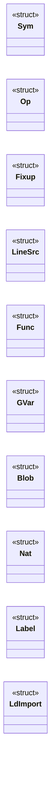

# `ld.c`

> Source: [ld.c:1](../../ld.c#L1) | language `c` | coverage 1.5% | [API index](../index.md)

## Contents

- **Structs:** [`Sym`](#sym), [`Op`](#op), [`Fixup`](#fixup), [`LineSrc`](#linesrc), [`Func`](#func), [`GVar`](#gvar), [`Blob`](#blob), [`Nat`](#nat), [`Label`](#label), [`LdImport`](#ldimport)
- **Functions:** [`image`](#image), [`main`](#main)
- **Macros:** [`CFG_MAX_SYMBOLS`](#cfg_max_symbols), [`CFG_MAX_FIXUPS`](#cfg_max_fixups), [`CFG_FIXUP_INIT`](#cfg_fixup_init), [`CFG_LINE_MAX`](#cfg_line_max), [`CFG_NAME_MAX`](#cfg_name_max), [`CFG_MAX_NATS`](#cfg_max_nats), [`CFG_MAX_ERRORS`](#cfg_max_errors), [`CFG_GROW_UNIT`](#cfg_grow_unit), [`CFG_ABI_BYTES`](#cfg_abi_bytes), [`CFG_STACK_BASE`](#cfg_stack_base), [`CFG_XSTACK_DEF`](#cfg_xstack_def), [`CFG_MAX_ARGS`](#cfg_max_args), [`CFG_REG_LOCALS`](#cfg_reg_locals), [`CFG_SLOT_FLAGS_A`](#cfg_slot_flags_a), [`CFG_SLOT_FLAGS_B`](#cfg_slot_flags_b), [`CFG_SLOT_S0`](#cfg_slot_s0), [`CFG_SLOT_S1`](#cfg_slot_s1), [`CFG_GSLOT_RSP`](#cfg_gslot_rsp), [`CFG_GSLOT_RBP`](#cfg_gslot_rbp), [`CFG_GSLOT_ARGS`](#cfg_gslot_args), [`CFG_GSLOT_RET`](#cfg_gslot_ret), [`CFG_CVM_MAGIC_0`](#cfg_cvm_magic_0), [`CFG_CVM_MAGIC_1`](#cfg_cvm_magic_1), [`CFG_CVM_MAGIC_2`](#cfg_cvm_magic_2), [`CFG_CVM_MAGIC_3`](#cfg_cvm_magic_3), [`CFG_CVM_VER_MAJ`](#cfg_cvm_ver_maj), [`CFG_CVM_VER_MIN`](#cfg_cvm_ver_min), [`CFG_CVM_HDR_SIZE`](#cfg_cvm_hdr_size), [`CFG_ELF_PAGE`](#cfg_elf_page), [`CFG_ELF_HSIZE`](#cfg_elf_hsize), [`CFG_ELF_PHENTSZ`](#cfg_elf_phentsz), [`CFG_ELF_PHNUM`](#cfg_elf_phnum), [`CFG_ELF_SHENTSZ`](#cfg_elf_shentsz), [`CFG_ELF_SHNUM`](#cfg_elf_shnum), [`CFG_ELF_SHSTRNDX`](#cfg_elf_shstrndx), [`CFG_ELF_ET_DYN`](#cfg_elf_et_dyn), [`CFG_ELF_EM_X8664`](#cfg_elf_em_x8664), [`CFG_ELF_PF_R`](#cfg_elf_pf_r), [`CFG_ELF_PF_W`](#cfg_elf_pf_w), [`CFG_ELF_PF_X`](#cfg_elf_pf_x), [`CFG_ELF_PT_LOAD`](#cfg_elf_pt_load), [`CFG_ELF_PT_DYNAMIC`](#cfg_elf_pt_dynamic), [`CFG_ELF_PT_GNU_STACK`](#cfg_elf_pt_gnu_stack), [`CFG_ELF_SHT_PROGBITS`](#cfg_elf_sht_progbits), [`CFG_ELF_SHT_NOBITS`](#cfg_elf_sht_nobits), [`CFG_ELF_SHT_STRTAB`](#cfg_elf_sht_strtab), [`CFG_ELF_SHT_HASH`](#cfg_elf_sht_hash), [`CFG_ELF_SHT_DYNAMIC`](#cfg_elf_sht_dynamic), [`CFG_ELF_SHT_DYNSYM`](#cfg_elf_sht_dynsym), [`CFG_ELF_SHT_RELA`](#cfg_elf_sht_rela), [`CFG_ELF_DT_NULL`](#cfg_elf_dt_null), [`CFG_ELF_DT_NEEDED`](#cfg_elf_dt_needed), [`CFG_ELF_DT_RELA`](#cfg_elf_dt_rela), [`CFG_ELF_DT_RELASZ`](#cfg_elf_dt_relasz), [`CFG_ELF_DT_RELAENT`](#cfg_elf_dt_relaent), [`CFG_ELF_DT_HASH`](#cfg_elf_dt_hash), [`CFG_ELF_DT_STRTAB`](#cfg_elf_dt_strtab), [`CFG_ELF_DT_SYMTAB`](#cfg_elf_dt_symtab), [`CFG_ELF_DT_STRSZ`](#cfg_elf_dt_strsz), [`CFG_ELF_DT_SYMENT`](#cfg_elf_dt_syment), [`CFG_ELF_DT_SONAME`](#cfg_elf_dt_soname), [`CFG_ELF_STB_GLOBAL`](#cfg_elf_stb_global), [`CFG_ELF_STT_NOTYPE`](#cfg_elf_stt_notype), [`CFG_ELF_STT_FUNC`](#cfg_elf_stt_func), [`CFG_ELF_R_GLOB_DAT`](#cfg_elf_r_glob_dat), [`CFG_ELF_R_RELATIVE`](#cfg_elf_r_relative), [`CFG_ELF_SHN_UNDEF`](#cfg_elf_shn_undef), [`CFG_LD_MAXLIBS`](#cfg_ld_maxlibs), [`CFG_LD_MAXIMPORTS`](#cfg_ld_maximports), [`CFG_LD_LIB_MAXSZ`](#cfg_ld_lib_maxsz), [`CFG_ELF_DYN_NENTRY`](#cfg_elf_dyn_nentry), [`CFG_ELF_DYNSYM_ENT`](#cfg_elf_dynsym_ent), [`CFG_ELF_SHF_A`](#cfg_elf_shf_a), [`CFG_ELF_SHF_X`](#cfg_elf_shf_x), [`CFG_ELF_SHF_W`](#cfg_elf_shf_w), [`CFG_ELF_TEXT_BASE`](#cfg_elf_text_base), [`CFG_FMT_CVM`](#cfg_fmt_cvm), [`CFG_FMT_ELF`](#cfg_fmt_elf), [`X86_G1_ADD`](#x86_g1_add), [`X86_G1_OR`](#x86_g1_or), [`X86_G1_AND`](#x86_g1_and), [`X86_G1_SUB`](#x86_g1_sub), [`X86_G1_XOR`](#x86_g1_xor), [`X86_G1_CMP`](#x86_g1_cmp), [`X86_JCC_JE`](#x86_jcc_je), [`X86_JCC_JNE`](#x86_jcc_jne), [`X86_JCC_JL`](#x86_jcc_jl), [`X86_JCC_JG`](#x86_jcc_jg), [`X86_JCC_JLE`](#x86_jcc_jle), [`X86_JCC_JGE`](#x86_jcc_jge), [`X86_JCC_JA`](#x86_jcc_ja), [`X86_JCC_JAE`](#x86_jcc_jae), [`X86_JCC_JB`](#x86_jcc_jb), [`X86_JCC_JBE`](#x86_jcc_jbe), [`X86_SET_E`](#x86_set_e), [`X86_SET_NE`](#x86_set_ne), [`X86_SET_L`](#x86_set_l), [`X86_SET_G`](#x86_set_g), [`X86_SET_LE`](#x86_set_le), [`X86_SET_GE`](#x86_set_ge), [`X86_SET_A`](#x86_set_a), [`X86_SET_AE`](#x86_set_ae), [`X86_SET_B`](#x86_set_b), [`X86_SET_BE`](#x86_set_be), [`X86_SYS_WRITE`](#x86_sys_write), [`X86_SYS_READ`](#x86_sys_read), [`X86_SYS_OPEN`](#x86_sys_open), [`X86_SYS_CLOSE`](#x86_sys_close), [`X86_SYS_LSEEK`](#x86_sys_lseek), [`X86_SYS_BRK`](#x86_sys_brk), [`X86_SYS_EXIT`](#x86_sys_exit), [`X86_SYS_EXIT_GROUP`](#x86_sys_exit_group), [`REG_RAX`](#reg_rax), [`REG_RCX`](#reg_rcx), [`REG_RDX`](#reg_rdx), [`REG_RBX`](#reg_rbx), [`REG_RSP`](#reg_rsp), [`REG_RBP`](#reg_rbp), [`REG_RSI`](#reg_rsi), [`REG_RDI`](#reg_rdi), [`SEC_TEXT`](#sec_text), [`SEC_BSS`](#sec_bss), [`SEC_DATA`](#sec_data), [`SEC_RODATA`](#sec_rodata), [`SYM_FUNC`](#sym_func), [`SYM_LABEL`](#sym_label), [`SYM_GLOBAL`](#sym_global), [`SYM_BLOB`](#sym_blob), [`K_REG`](#k_reg), [`K_IMM`](#k_imm), [`K_MEM`](#k_mem), [`K_SYM`](#k_sym), [`K_SYM_IMM`](#k_sym_imm), [`K_IND`](#k_ind), [`OP_NOP`](#op_nop), [`OP_PUSH_IMM64`](#op_push_imm64), [`OP_PUSH_IMM32`](#op_push_imm32), [`OP_PUSH_IMM8`](#op_push_imm8), [`OP_PUSH_ZERO`](#op_push_zero), [`OP_PUSH_ONE`](#op_push_one), [`OP_PUSH_LOCAL`](#op_push_local), [`OP_STORE_LOCAL`](#op_store_local), [`OP_PUSH_GLOBAL`](#op_push_global), [`OP_STORE_GLOBAL`](#op_store_global), [`OP_ADD`](#op_add), [`OP_SUB`](#op_sub), [`OP_MUL`](#op_mul), [`OP_DIV`](#op_div), [`OP_MOD`](#op_mod), [`OP_NEG`](#op_neg), [`OP_UDIV`](#op_udiv), [`OP_UMOD`](#op_umod), [`OP_AND`](#op_and), [`OP_OR`](#op_or), [`OP_XOR`](#op_xor), [`OP_NOT`](#op_not), [`OP_SHL`](#op_shl), [`OP_SHR`](#op_shr), [`OP_USHR`](#op_ushr), [`OP_CMP_EQ`](#op_cmp_eq), [`OP_CMP_NE`](#op_cmp_ne), [`OP_CMP_LT`](#op_cmp_lt), [`OP_CMP_LE`](#op_cmp_le), [`OP_CMP_GT`](#op_cmp_gt), [`OP_CMP_GE`](#op_cmp_ge), [`OP_LNOT`](#op_lnot), [`OP_CMP_ULT`](#op_cmp_ult), [`OP_CMP_ULE`](#op_cmp_ule), [`OP_CMP_UGT`](#op_cmp_ugt), [`OP_CMP_UGE`](#op_cmp_uge), [`OP_JMP`](#op_jmp), [`OP_JZ`](#op_jz), [`OP_JNZ`](#op_jnz), [`OP_CALL`](#op_call), [`OP_RET`](#op_ret), [`OP_CALL_NATIVE`](#op_call_native), [`OP_CALL_INDIRECT`](#op_call_indirect), [`OP_LOAD8`](#op_load8), [`OP_LOAD16`](#op_load16), [`OP_LOAD32`](#op_load32), [`OP_LOAD64`](#op_load64), [`OP_STORE8`](#op_store8), [`OP_STORE16`](#op_store16), [`OP_STORE32`](#op_store32), [`OP_STORE64`](#op_store64), [`OP_LEA_LOCAL`](#op_lea_local), [`OP_LEA_GLOBAL`](#op_lea_global), [`OP_ALLOC`](#op_alloc), [`OP_FREE`](#op_free), [`OP_LEA_DATA`](#op_lea_data), [`OP_SYSCALL`](#op_syscall), [`OP_HALT`](#op_halt)

## Type Diagram



## Structs

<a id="sym"></a>

### `Sym`

`struct` | [ld.c:241](../../ld.c#L241)

```c
typedef struct
```

---

<a id="op"></a>

### `Op`

`struct` | [ld.c:256](../../ld.c#L256)

```c
typedef struct
```

---

<a id="fixup"></a>

### `Fixup`

`struct` | [ld.c:271](../../ld.c#L271)

```c
typedef struct
```

---

<a id="linesrc"></a>

### `LineSrc`

`struct` | [ld.c:277](../../ld.c#L277)

```c
typedef struct
```

---

<a id="func"></a>

### `Func`

`struct` | [ld.c:285](../../ld.c#L285)

```c
typedef struct
```

---

<a id="gvar"></a>

### `GVar`

`struct` | [ld.c:292](../../ld.c#L292)

```c
typedef struct
```

---

<a id="blob"></a>

### `Blob`

`struct` | [ld.c:299](../../ld.c#L299)

```c
typedef struct
```

---

<a id="nat"></a>

### `Nat`

`struct` | [ld.c:306](../../ld.c#L306)

```c
typedef struct
```

---

<a id="label"></a>

### `Label`

`struct` | [ld.c:310](../../ld.c#L310)

```c
typedef struct
```

---

<a id="ldimport"></a>

### `LdImport`

`struct` | [ld.c:391](../../ld.c#L391)

```c
typedef struct
```

-d libraries (L2): verified import names plus the SONAMEs the
executable records as DT_NEEDED. Parsed eagerly after argument
parsing so link errors name the missing library, never a raw
offset.

---

## Functions

<a id="image"></a>

### `image`

`function` | [ld.c:4469](../../ld.c#L4469)

```c
* any exact loader refuses the image (glibc only survives on * page slack). */ w64_at(ph + 96, (unsigned long long)((elf_bss_base + elf_bss_size) - elf_data_base));
```

**Parameters**

| Name | Type | Default | Description |
|---|---|---|---|
| `slack` | `glibc only survives on * page` |  |  |

**Returns:** `* any exact loader refuses the`

---

<a id="main"></a>

### `main`

`function` | [ld.c:4985](../../ld.c#L4985)

```c
int main(int argc, char **argv)
```

**Parameters**

| Name | Type | Default | Description |
|---|---|---|---|
| `argc` | `int` |  |  |
| `argv` | `char **` |  |  |

**Returns:** `int`

---

## Macros

<a id="cfg_max_symbols"></a>

### `CFG_MAX_SYMBOLS`

`macro` | [ld.c:25](../../ld.c#L25)

```c
#define CFG_MAX_SYMBOLS
```

---

<a id="cfg_max_fixups"></a>

### `CFG_MAX_FIXUPS`

`macro` | [ld.c:26](../../ld.c#L26)

```c
#define CFG_MAX_FIXUPS
```

---

<a id="cfg_fixup_init"></a>

### `CFG_FIXUP_INIT`

`macro` | [ld.c:27](../../ld.c#L27)

```c
#define CFG_FIXUP_INIT
```

---

<a id="cfg_line_max"></a>

### `CFG_LINE_MAX`

`macro` | [ld.c:28](../../ld.c#L28)

```c
#define CFG_LINE_MAX
```

---

<a id="cfg_name_max"></a>

### `CFG_NAME_MAX`

`macro` | [ld.c:29](../../ld.c#L29)

```c
#define CFG_NAME_MAX
```

---

<a id="cfg_max_nats"></a>

### `CFG_MAX_NATS`

`macro` | [ld.c:30](../../ld.c#L30)

```c
#define CFG_MAX_NATS
```

---

<a id="cfg_max_errors"></a>

### `CFG_MAX_ERRORS`

`macro` | [ld.c:31](../../ld.c#L31)

```c
#define CFG_MAX_ERRORS
```

---

<a id="cfg_grow_unit"></a>

### `CFG_GROW_UNIT`

`macro` | [ld.c:32](../../ld.c#L32)

```c
#define CFG_GROW_UNIT
```

---

<a id="cfg_abi_bytes"></a>

### `CFG_ABI_BYTES`

`macro` | [ld.c:34](../../ld.c#L34)

```c
#define CFG_ABI_BYTES
```

---

<a id="cfg_stack_base"></a>

### `CFG_STACK_BASE`

`macro` | [ld.c:35](../../ld.c#L35)

```c
#define CFG_STACK_BASE
```

---

<a id="cfg_xstack_def"></a>

### `CFG_XSTACK_DEF`

`macro` | [ld.c:36](../../ld.c#L36)

```c
#define CFG_XSTACK_DEF
```

---

<a id="cfg_max_args"></a>

### `CFG_MAX_ARGS`

`macro` | [ld.c:40](../../ld.c#L40)

```c
#define CFG_MAX_ARGS
```

Room reserved past the stack region for the argv pointer array that the interpreter builds at the stack top; an argument list longer than this cap is rejected by the interpreter, never silently truncated.

---

<a id="cfg_reg_locals"></a>

### `CFG_REG_LOCALS`

`macro` | [ld.c:42](../../ld.c#L42)

```c
#define CFG_REG_LOCALS
```

---

<a id="cfg_slot_flags_a"></a>

### `CFG_SLOT_FLAGS_A`

`macro` | [ld.c:43](../../ld.c#L43)

```c
#define CFG_SLOT_FLAGS_A
```

---

<a id="cfg_slot_flags_b"></a>

### `CFG_SLOT_FLAGS_B`

`macro` | [ld.c:44](../../ld.c#L44)

```c
#define CFG_SLOT_FLAGS_B
```

---

<a id="cfg_slot_s0"></a>

### `CFG_SLOT_S0`

`macro` | [ld.c:45](../../ld.c#L45)

```c
#define CFG_SLOT_S0
```

---

<a id="cfg_slot_s1"></a>

### `CFG_SLOT_S1`

`macro` | [ld.c:46](../../ld.c#L46)

```c
#define CFG_SLOT_S1
```

---

<a id="cfg_gslot_rsp"></a>

### `CFG_GSLOT_RSP`

`macro` | [ld.c:48](../../ld.c#L48)

```c
#define CFG_GSLOT_RSP
```

---

<a id="cfg_gslot_rbp"></a>

### `CFG_GSLOT_RBP`

`macro` | [ld.c:49](../../ld.c#L49)

```c
#define CFG_GSLOT_RBP
```

---

<a id="cfg_gslot_args"></a>

### `CFG_GSLOT_ARGS`

`macro` | [ld.c:50](../../ld.c#L50)

```c
#define CFG_GSLOT_ARGS
```

---

<a id="cfg_gslot_ret"></a>

### `CFG_GSLOT_RET`

`macro` | [ld.c:51](../../ld.c#L51)

```c
#define CFG_GSLOT_RET
```

---

<a id="cfg_cvm_magic_0"></a>

### `CFG_CVM_MAGIC_0`

`macro` | [ld.c:53](../../ld.c#L53)

```c
#define CFG_CVM_MAGIC_0
```

---

<a id="cfg_cvm_magic_1"></a>

### `CFG_CVM_MAGIC_1`

`macro` | [ld.c:54](../../ld.c#L54)

```c
#define CFG_CVM_MAGIC_1
```

---

<a id="cfg_cvm_magic_2"></a>

### `CFG_CVM_MAGIC_2`

`macro` | [ld.c:55](../../ld.c#L55)

```c
#define CFG_CVM_MAGIC_2
```

---

<a id="cfg_cvm_magic_3"></a>

### `CFG_CVM_MAGIC_3`

`macro` | [ld.c:56](../../ld.c#L56)

```c
#define CFG_CVM_MAGIC_3
```

---

<a id="cfg_cvm_ver_maj"></a>

### `CFG_CVM_VER_MAJ`

`macro` | [ld.c:57](../../ld.c#L57)

```c
#define CFG_CVM_VER_MAJ
```

---

<a id="cfg_cvm_ver_min"></a>

### `CFG_CVM_VER_MIN`

`macro` | [ld.c:58](../../ld.c#L58)

```c
#define CFG_CVM_VER_MIN
```

---

<a id="cfg_cvm_hdr_size"></a>

### `CFG_CVM_HDR_SIZE`

`macro` | [ld.c:59](../../ld.c#L59)

```c
#define CFG_CVM_HDR_SIZE
```

---

<a id="cfg_elf_page"></a>

### `CFG_ELF_PAGE`

`macro` | [ld.c:61](../../ld.c#L61)

```c
#define CFG_ELF_PAGE
```

---

<a id="cfg_elf_hsize"></a>

### `CFG_ELF_HSIZE`

`macro` | [ld.c:62](../../ld.c#L62)

```c
#define CFG_ELF_HSIZE
```

---

<a id="cfg_elf_phentsz"></a>

### `CFG_ELF_PHENTSZ`

`macro` | [ld.c:63](../../ld.c#L63)

```c
#define CFG_ELF_PHENTSZ
```

---

<a id="cfg_elf_phnum"></a>

### `CFG_ELF_PHNUM`

`macro` | [ld.c:64](../../ld.c#L64)

```c
#define CFG_ELF_PHNUM
```

---

<a id="cfg_elf_shentsz"></a>

### `CFG_ELF_SHENTSZ`

`macro` | [ld.c:65](../../ld.c#L65)

```c
#define CFG_ELF_SHENTSZ
```

---

<a id="cfg_elf_shnum"></a>

### `CFG_ELF_SHNUM`

`macro` | [ld.c:66](../../ld.c#L66)

```c
#define CFG_ELF_SHNUM
```

---

<a id="cfg_elf_shstrndx"></a>

### `CFG_ELF_SHSTRNDX`

`macro` | [ld.c:67](../../ld.c#L67)

```c
#define CFG_ELF_SHSTRNDX
```

---

<a id="cfg_elf_et_dyn"></a>

### `CFG_ELF_ET_DYN`

`macro` | [ld.c:68](../../ld.c#L68)

```c
#define CFG_ELF_ET_DYN
```

---

<a id="cfg_elf_em_x8664"></a>

### `CFG_ELF_EM_X8664`

`macro` | [ld.c:69](../../ld.c#L69)

```c
#define CFG_ELF_EM_X8664
```

---

<a id="cfg_elf_pf_r"></a>

### `CFG_ELF_PF_R`

`macro` | [ld.c:70](../../ld.c#L70)

```c
#define CFG_ELF_PF_R
```

---

<a id="cfg_elf_pf_w"></a>

### `CFG_ELF_PF_W`

`macro` | [ld.c:71](../../ld.c#L71)

```c
#define CFG_ELF_PF_W
```

---

<a id="cfg_elf_pf_x"></a>

### `CFG_ELF_PF_X`

`macro` | [ld.c:72](../../ld.c#L72)

```c
#define CFG_ELF_PF_X
```

---

<a id="cfg_elf_pt_load"></a>

### `CFG_ELF_PT_LOAD`

`macro` | [ld.c:73](../../ld.c#L73)

```c
#define CFG_ELF_PT_LOAD
```

---

<a id="cfg_elf_pt_dynamic"></a>

### `CFG_ELF_PT_DYNAMIC`

`macro` | [ld.c:74](../../ld.c#L74)

```c
#define CFG_ELF_PT_DYNAMIC
```

---

<a id="cfg_elf_pt_gnu_stack"></a>

### `CFG_ELF_PT_GNU_STACK`

`macro` | [ld.c:75](../../ld.c#L75)

```c
#define CFG_ELF_PT_GNU_STACK
```

---

<a id="cfg_elf_sht_progbits"></a>

### `CFG_ELF_SHT_PROGBITS`

`macro` | [ld.c:76](../../ld.c#L76)

```c
#define CFG_ELF_SHT_PROGBITS
```

---

<a id="cfg_elf_sht_nobits"></a>

### `CFG_ELF_SHT_NOBITS`

`macro` | [ld.c:77](../../ld.c#L77)

```c
#define CFG_ELF_SHT_NOBITS
```

---

<a id="cfg_elf_sht_strtab"></a>

### `CFG_ELF_SHT_STRTAB`

`macro` | [ld.c:78](../../ld.c#L78)

```c
#define CFG_ELF_SHT_STRTAB
```

---

<a id="cfg_elf_sht_hash"></a>

### `CFG_ELF_SHT_HASH`

`macro` | [ld.c:79](../../ld.c#L79)

```c
#define CFG_ELF_SHT_HASH
```

---

<a id="cfg_elf_sht_dynamic"></a>

### `CFG_ELF_SHT_DYNAMIC`

`macro` | [ld.c:80](../../ld.c#L80)

```c
#define CFG_ELF_SHT_DYNAMIC
```

---

<a id="cfg_elf_sht_dynsym"></a>

### `CFG_ELF_SHT_DYNSYM`

`macro` | [ld.c:81](../../ld.c#L81)

```c
#define CFG_ELF_SHT_DYNSYM
```

---

<a id="cfg_elf_sht_rela"></a>

### `CFG_ELF_SHT_RELA`

`macro` | [ld.c:82](../../ld.c#L82)

```c
#define CFG_ELF_SHT_RELA
```

---

<a id="cfg_elf_dt_null"></a>

### `CFG_ELF_DT_NULL`

`macro` | [ld.c:83](../../ld.c#L83)

```c
#define CFG_ELF_DT_NULL
```

---

<a id="cfg_elf_dt_needed"></a>

### `CFG_ELF_DT_NEEDED`

`macro` | [ld.c:84](../../ld.c#L84)

```c
#define CFG_ELF_DT_NEEDED
```

---

<a id="cfg_elf_dt_rela"></a>

### `CFG_ELF_DT_RELA`

`macro` | [ld.c:85](../../ld.c#L85)

```c
#define CFG_ELF_DT_RELA
```

---

<a id="cfg_elf_dt_relasz"></a>

### `CFG_ELF_DT_RELASZ`

`macro` | [ld.c:86](../../ld.c#L86)

```c
#define CFG_ELF_DT_RELASZ
```

---

<a id="cfg_elf_dt_relaent"></a>

### `CFG_ELF_DT_RELAENT`

`macro` | [ld.c:87](../../ld.c#L87)

```c
#define CFG_ELF_DT_RELAENT
```

---

<a id="cfg_elf_dt_hash"></a>

### `CFG_ELF_DT_HASH`

`macro` | [ld.c:88](../../ld.c#L88)

```c
#define CFG_ELF_DT_HASH
```

---

<a id="cfg_elf_dt_strtab"></a>

### `CFG_ELF_DT_STRTAB`

`macro` | [ld.c:89](../../ld.c#L89)

```c
#define CFG_ELF_DT_STRTAB
```

---

<a id="cfg_elf_dt_symtab"></a>

### `CFG_ELF_DT_SYMTAB`

`macro` | [ld.c:90](../../ld.c#L90)

```c
#define CFG_ELF_DT_SYMTAB
```

---

<a id="cfg_elf_dt_strsz"></a>

### `CFG_ELF_DT_STRSZ`

`macro` | [ld.c:91](../../ld.c#L91)

```c
#define CFG_ELF_DT_STRSZ
```

---

<a id="cfg_elf_dt_syment"></a>

### `CFG_ELF_DT_SYMENT`

`macro` | [ld.c:92](../../ld.c#L92)

```c
#define CFG_ELF_DT_SYMENT
```

---

<a id="cfg_elf_dt_soname"></a>

### `CFG_ELF_DT_SONAME`

`macro` | [ld.c:93](../../ld.c#L93)

```c
#define CFG_ELF_DT_SONAME
```

---

<a id="cfg_elf_stb_global"></a>

### `CFG_ELF_STB_GLOBAL`

`macro` | [ld.c:94](../../ld.c#L94)

```c
#define CFG_ELF_STB_GLOBAL
```

---

<a id="cfg_elf_stt_notype"></a>

### `CFG_ELF_STT_NOTYPE`

`macro` | [ld.c:95](../../ld.c#L95)

```c
#define CFG_ELF_STT_NOTYPE
```

---

<a id="cfg_elf_stt_func"></a>

### `CFG_ELF_STT_FUNC`

`macro` | [ld.c:96](../../ld.c#L96)

```c
#define CFG_ELF_STT_FUNC
```

---

<a id="cfg_elf_r_glob_dat"></a>

### `CFG_ELF_R_GLOB_DAT`

`macro` | [ld.c:97](../../ld.c#L97)

```c
#define CFG_ELF_R_GLOB_DAT
```

---

<a id="cfg_elf_r_relative"></a>

### `CFG_ELF_R_RELATIVE`

`macro` | [ld.c:98](../../ld.c#L98)

```c
#define CFG_ELF_R_RELATIVE
```

---

<a id="cfg_elf_shn_undef"></a>

### `CFG_ELF_SHN_UNDEF`

`macro` | [ld.c:99](../../ld.c#L99)

```c
#define CFG_ELF_SHN_UNDEF
```

---

<a id="cfg_ld_maxlibs"></a>

### `CFG_LD_MAXLIBS`

`macro` | [ld.c:100](../../ld.c#L100)

```c
#define CFG_LD_MAXLIBS
```

---

<a id="cfg_ld_maximports"></a>

### `CFG_LD_MAXIMPORTS`

`macro` | [ld.c:101](../../ld.c#L101)

```c
#define CFG_LD_MAXIMPORTS
```

---

<a id="cfg_ld_lib_maxsz"></a>

### `CFG_LD_LIB_MAXSZ`

`macro` | [ld.c:102](../../ld.c#L102)

```c
#define CFG_LD_LIB_MAXSZ
```

---

<a id="cfg_elf_dyn_nentry"></a>

### `CFG_ELF_DYN_NENTRY`

`macro` | [ld.c:103](../../ld.c#L103)

```c
#define CFG_ELF_DYN_NENTRY
```

---

<a id="cfg_elf_dynsym_ent"></a>

### `CFG_ELF_DYNSYM_ENT`

`macro` | [ld.c:104](../../ld.c#L104)

```c
#define CFG_ELF_DYNSYM_ENT
```

---

<a id="cfg_elf_shf_a"></a>

### `CFG_ELF_SHF_A`

`macro` | [ld.c:105](../../ld.c#L105)

```c
#define CFG_ELF_SHF_A
```

---

<a id="cfg_elf_shf_x"></a>

### `CFG_ELF_SHF_X`

`macro` | [ld.c:106](../../ld.c#L106)

```c
#define CFG_ELF_SHF_X
```

---

<a id="cfg_elf_shf_w"></a>

### `CFG_ELF_SHF_W`

`macro` | [ld.c:107](../../ld.c#L107)

```c
#define CFG_ELF_SHF_W
```

---

<a id="cfg_elf_text_base"></a>

### `CFG_ELF_TEXT_BASE`

`macro` | [ld.c:108](../../ld.c#L108)

```c
#define CFG_ELF_TEXT_BASE
```

---

<a id="cfg_fmt_cvm"></a>

### `CFG_FMT_CVM`

`macro` | [ld.c:110](../../ld.c#L110)

```c
#define CFG_FMT_CVM
```

---

<a id="cfg_fmt_elf"></a>

### `CFG_FMT_ELF`

`macro` | [ld.c:111](../../ld.c#L111)

```c
#define CFG_FMT_ELF
```

---

<a id="x86_g1_add"></a>

### `X86_G1_ADD`

`macro` | [ld.c:114](../../ld.c#L114)

```c
#define X86_G1_ADD
```

x86 opcode groups

---

<a id="x86_g1_or"></a>

### `X86_G1_OR`

`macro` | [ld.c:115](../../ld.c#L115)

```c
#define X86_G1_OR
```

---

<a id="x86_g1_and"></a>

### `X86_G1_AND`

`macro` | [ld.c:116](../../ld.c#L116)

```c
#define X86_G1_AND
```

---

<a id="x86_g1_sub"></a>

### `X86_G1_SUB`

`macro` | [ld.c:117](../../ld.c#L117)

```c
#define X86_G1_SUB
```

---

<a id="x86_g1_xor"></a>

### `X86_G1_XOR`

`macro` | [ld.c:118](../../ld.c#L118)

```c
#define X86_G1_XOR
```

---

<a id="x86_g1_cmp"></a>

### `X86_G1_CMP`

`macro` | [ld.c:119](../../ld.c#L119)

```c
#define X86_G1_CMP
```

---

<a id="x86_jcc_je"></a>

### `X86_JCC_JE`

`macro` | [ld.c:121](../../ld.c#L121)

```c
#define X86_JCC_JE
```

---

<a id="x86_jcc_jne"></a>

### `X86_JCC_JNE`

`macro` | [ld.c:122](../../ld.c#L122)

```c
#define X86_JCC_JNE
```

---

<a id="x86_jcc_jl"></a>

### `X86_JCC_JL`

`macro` | [ld.c:123](../../ld.c#L123)

```c
#define X86_JCC_JL
```

---

<a id="x86_jcc_jg"></a>

### `X86_JCC_JG`

`macro` | [ld.c:124](../../ld.c#L124)

```c
#define X86_JCC_JG
```

---

<a id="x86_jcc_jle"></a>

### `X86_JCC_JLE`

`macro` | [ld.c:125](../../ld.c#L125)

```c
#define X86_JCC_JLE
```

---

<a id="x86_jcc_jge"></a>

### `X86_JCC_JGE`

`macro` | [ld.c:126](../../ld.c#L126)

```c
#define X86_JCC_JGE
```

---

<a id="x86_jcc_ja"></a>

### `X86_JCC_JA`

`macro` | [ld.c:127](../../ld.c#L127)

```c
#define X86_JCC_JA
```

---

<a id="x86_jcc_jae"></a>

### `X86_JCC_JAE`

`macro` | [ld.c:128](../../ld.c#L128)

```c
#define X86_JCC_JAE
```

---

<a id="x86_jcc_jb"></a>

### `X86_JCC_JB`

`macro` | [ld.c:129](../../ld.c#L129)

```c
#define X86_JCC_JB
```

---

<a id="x86_jcc_jbe"></a>

### `X86_JCC_JBE`

`macro` | [ld.c:130](../../ld.c#L130)

```c
#define X86_JCC_JBE
```

---

<a id="x86_set_e"></a>

### `X86_SET_E`

`macro` | [ld.c:132](../../ld.c#L132)

```c
#define X86_SET_E
```

---

<a id="x86_set_ne"></a>

### `X86_SET_NE`

`macro` | [ld.c:133](../../ld.c#L133)

```c
#define X86_SET_NE
```

---

<a id="x86_set_l"></a>

### `X86_SET_L`

`macro` | [ld.c:134](../../ld.c#L134)

```c
#define X86_SET_L
```

---

<a id="x86_set_g"></a>

### `X86_SET_G`

`macro` | [ld.c:135](../../ld.c#L135)

```c
#define X86_SET_G
```

---

<a id="x86_set_le"></a>

### `X86_SET_LE`

`macro` | [ld.c:136](../../ld.c#L136)

```c
#define X86_SET_LE
```

---

<a id="x86_set_ge"></a>

### `X86_SET_GE`

`macro` | [ld.c:137](../../ld.c#L137)

```c
#define X86_SET_GE
```

---

<a id="x86_set_a"></a>

### `X86_SET_A`

`macro` | [ld.c:138](../../ld.c#L138)

```c
#define X86_SET_A
```

---

<a id="x86_set_ae"></a>

### `X86_SET_AE`

`macro` | [ld.c:139](../../ld.c#L139)

```c
#define X86_SET_AE
```

---

<a id="x86_set_b"></a>

### `X86_SET_B`

`macro` | [ld.c:140](../../ld.c#L140)

```c
#define X86_SET_B
```

---

<a id="x86_set_be"></a>

### `X86_SET_BE`

`macro` | [ld.c:141](../../ld.c#L141)

```c
#define X86_SET_BE
```

---

<a id="x86_sys_write"></a>

### `X86_SYS_WRITE`

`macro` | [ld.c:143](../../ld.c#L143)

```c
#define X86_SYS_WRITE
```

---

<a id="x86_sys_read"></a>

### `X86_SYS_READ`

`macro` | [ld.c:144](../../ld.c#L144)

```c
#define X86_SYS_READ
```

---

<a id="x86_sys_open"></a>

### `X86_SYS_OPEN`

`macro` | [ld.c:145](../../ld.c#L145)

```c
#define X86_SYS_OPEN
```

---

<a id="x86_sys_close"></a>

### `X86_SYS_CLOSE`

`macro` | [ld.c:146](../../ld.c#L146)

```c
#define X86_SYS_CLOSE
```

---

<a id="x86_sys_lseek"></a>

### `X86_SYS_LSEEK`

`macro` | [ld.c:147](../../ld.c#L147)

```c
#define X86_SYS_LSEEK
```

---

<a id="x86_sys_brk"></a>

### `X86_SYS_BRK`

`macro` | [ld.c:148](../../ld.c#L148)

```c
#define X86_SYS_BRK
```

---

<a id="x86_sys_exit"></a>

### `X86_SYS_EXIT`

`macro` | [ld.c:149](../../ld.c#L149)

```c
#define X86_SYS_EXIT
```

---

<a id="x86_sys_exit_group"></a>

### `X86_SYS_EXIT_GROUP`

`macro` | [ld.c:150](../../ld.c#L150)

```c
#define X86_SYS_EXIT_GROUP
```

---

<a id="reg_rax"></a>

### `REG_RAX`

`macro` | [ld.c:152](../../ld.c#L152)

```c
#define REG_RAX
```

---

<a id="reg_rcx"></a>

### `REG_RCX`

`macro` | [ld.c:153](../../ld.c#L153)

```c
#define REG_RCX
```

---

<a id="reg_rdx"></a>

### `REG_RDX`

`macro` | [ld.c:154](../../ld.c#L154)

```c
#define REG_RDX
```

---

<a id="reg_rbx"></a>

### `REG_RBX`

`macro` | [ld.c:155](../../ld.c#L155)

```c
#define REG_RBX
```

---

<a id="reg_rsp"></a>

### `REG_RSP`

`macro` | [ld.c:156](../../ld.c#L156)

```c
#define REG_RSP
```

---

<a id="reg_rbp"></a>

### `REG_RBP`

`macro` | [ld.c:157](../../ld.c#L157)

```c
#define REG_RBP
```

---

<a id="reg_rsi"></a>

### `REG_RSI`

`macro` | [ld.c:158](../../ld.c#L158)

```c
#define REG_RSI
```

---

<a id="reg_rdi"></a>

### `REG_RDI`

`macro` | [ld.c:159](../../ld.c#L159)

```c
#define REG_RDI
```

---

<a id="sec_text"></a>

### `SEC_TEXT`

`macro` | [ld.c:161](../../ld.c#L161)

```c
#define SEC_TEXT
```

---

<a id="sec_bss"></a>

### `SEC_BSS`

`macro` | [ld.c:162](../../ld.c#L162)

```c
#define SEC_BSS
```

---

<a id="sec_data"></a>

### `SEC_DATA`

`macro` | [ld.c:163](../../ld.c#L163)

```c
#define SEC_DATA
```

---

<a id="sec_rodata"></a>

### `SEC_RODATA`

`macro` | [ld.c:164](../../ld.c#L164)

```c
#define SEC_RODATA
```

---

<a id="sym_func"></a>

### `SYM_FUNC`

`macro` | [ld.c:166](../../ld.c#L166)

```c
#define SYM_FUNC
```

---

<a id="sym_label"></a>

### `SYM_LABEL`

`macro` | [ld.c:167](../../ld.c#L167)

```c
#define SYM_LABEL
```

---

<a id="sym_global"></a>

### `SYM_GLOBAL`

`macro` | [ld.c:168](../../ld.c#L168)

```c
#define SYM_GLOBAL
```

---

<a id="sym_blob"></a>

### `SYM_BLOB`

`macro` | [ld.c:169](../../ld.c#L169)

```c
#define SYM_BLOB
```

---

<a id="k_reg"></a>

### `K_REG`

`macro` | [ld.c:171](../../ld.c#L171)

```c
#define K_REG
```

---

<a id="k_imm"></a>

### `K_IMM`

`macro` | [ld.c:172](../../ld.c#L172)

```c
#define K_IMM
```

---

<a id="k_mem"></a>

### `K_MEM`

`macro` | [ld.c:173](../../ld.c#L173)

```c
#define K_MEM
```

---

<a id="k_sym"></a>

### `K_SYM`

`macro` | [ld.c:174](../../ld.c#L174)

```c
#define K_SYM
```

---

<a id="k_sym_imm"></a>

### `K_SYM_IMM`

`macro` | [ld.c:175](../../ld.c#L175)

```c
#define K_SYM_IMM
```

---

<a id="k_ind"></a>

### `K_IND`

`macro` | [ld.c:176](../../ld.c#L176)

```c
#define K_IND
```

---

<a id="op_nop"></a>

### `OP_NOP`

`macro` | [ld.c:178](../../ld.c#L178)

```c
#define OP_NOP
```

---

<a id="op_push_imm64"></a>

### `OP_PUSH_IMM64`

`macro` | [ld.c:179](../../ld.c#L179)

```c
#define OP_PUSH_IMM64
```

---

<a id="op_push_imm32"></a>

### `OP_PUSH_IMM32`

`macro` | [ld.c:180](../../ld.c#L180)

```c
#define OP_PUSH_IMM32
```

---

<a id="op_push_imm8"></a>

### `OP_PUSH_IMM8`

`macro` | [ld.c:181](../../ld.c#L181)

```c
#define OP_PUSH_IMM8
```

---

<a id="op_push_zero"></a>

### `OP_PUSH_ZERO`

`macro` | [ld.c:182](../../ld.c#L182)

```c
#define OP_PUSH_ZERO
```

---

<a id="op_push_one"></a>

### `OP_PUSH_ONE`

`macro` | [ld.c:183](../../ld.c#L183)

```c
#define OP_PUSH_ONE
```

---

<a id="op_push_local"></a>

### `OP_PUSH_LOCAL`

`macro` | [ld.c:184](../../ld.c#L184)

```c
#define OP_PUSH_LOCAL
```

---

<a id="op_store_local"></a>

### `OP_STORE_LOCAL`

`macro` | [ld.c:185](../../ld.c#L185)

```c
#define OP_STORE_LOCAL
```

---

<a id="op_push_global"></a>

### `OP_PUSH_GLOBAL`

`macro` | [ld.c:186](../../ld.c#L186)

```c
#define OP_PUSH_GLOBAL
```

---

<a id="op_store_global"></a>

### `OP_STORE_GLOBAL`

`macro` | [ld.c:187](../../ld.c#L187)

```c
#define OP_STORE_GLOBAL
```

---

<a id="op_add"></a>

### `OP_ADD`

`macro` | [ld.c:188](../../ld.c#L188)

```c
#define OP_ADD
```

---

<a id="op_sub"></a>

### `OP_SUB`

`macro` | [ld.c:189](../../ld.c#L189)

```c
#define OP_SUB
```

---

<a id="op_mul"></a>

### `OP_MUL`

`macro` | [ld.c:190](../../ld.c#L190)

```c
#define OP_MUL
```

---

<a id="op_div"></a>

### `OP_DIV`

`macro` | [ld.c:191](../../ld.c#L191)

```c
#define OP_DIV
```

---

<a id="op_mod"></a>

### `OP_MOD`

`macro` | [ld.c:192](../../ld.c#L192)

```c
#define OP_MOD
```

---

<a id="op_neg"></a>

### `OP_NEG`

`macro` | [ld.c:193](../../ld.c#L193)

```c
#define OP_NEG
```

---

<a id="op_udiv"></a>

### `OP_UDIV`

`macro` | [ld.c:194](../../ld.c#L194)

```c
#define OP_UDIV
```

---

<a id="op_umod"></a>

### `OP_UMOD`

`macro` | [ld.c:195](../../ld.c#L195)

```c
#define OP_UMOD
```

---

<a id="op_and"></a>

### `OP_AND`

`macro` | [ld.c:196](../../ld.c#L196)

```c
#define OP_AND
```

---

<a id="op_or"></a>

### `OP_OR`

`macro` | [ld.c:197](../../ld.c#L197)

```c
#define OP_OR
```

---

<a id="op_xor"></a>

### `OP_XOR`

`macro` | [ld.c:198](../../ld.c#L198)

```c
#define OP_XOR
```

---

<a id="op_not"></a>

### `OP_NOT`

`macro` | [ld.c:199](../../ld.c#L199)

```c
#define OP_NOT
```

---

<a id="op_shl"></a>

### `OP_SHL`

`macro` | [ld.c:200](../../ld.c#L200)

```c
#define OP_SHL
```

---

<a id="op_shr"></a>

### `OP_SHR`

`macro` | [ld.c:201](../../ld.c#L201)

```c
#define OP_SHR
```

---

<a id="op_ushr"></a>

### `OP_USHR`

`macro` | [ld.c:202](../../ld.c#L202)

```c
#define OP_USHR
```

---

<a id="op_cmp_eq"></a>

### `OP_CMP_EQ`

`macro` | [ld.c:203](../../ld.c#L203)

```c
#define OP_CMP_EQ
```

---

<a id="op_cmp_ne"></a>

### `OP_CMP_NE`

`macro` | [ld.c:204](../../ld.c#L204)

```c
#define OP_CMP_NE
```

---

<a id="op_cmp_lt"></a>

### `OP_CMP_LT`

`macro` | [ld.c:205](../../ld.c#L205)

```c
#define OP_CMP_LT
```

---

<a id="op_cmp_le"></a>

### `OP_CMP_LE`

`macro` | [ld.c:206](../../ld.c#L206)

```c
#define OP_CMP_LE
```

---

<a id="op_cmp_gt"></a>

### `OP_CMP_GT`

`macro` | [ld.c:207](../../ld.c#L207)

```c
#define OP_CMP_GT
```

---

<a id="op_cmp_ge"></a>

### `OP_CMP_GE`

`macro` | [ld.c:208](../../ld.c#L208)

```c
#define OP_CMP_GE
```

---

<a id="op_lnot"></a>

### `OP_LNOT`

`macro` | [ld.c:209](../../ld.c#L209)

```c
#define OP_LNOT
```

---

<a id="op_cmp_ult"></a>

### `OP_CMP_ULT`

`macro` | [ld.c:210](../../ld.c#L210)

```c
#define OP_CMP_ULT
```

---

<a id="op_cmp_ule"></a>

### `OP_CMP_ULE`

`macro` | [ld.c:211](../../ld.c#L211)

```c
#define OP_CMP_ULE
```

---

<a id="op_cmp_ugt"></a>

### `OP_CMP_UGT`

`macro` | [ld.c:212](../../ld.c#L212)

```c
#define OP_CMP_UGT
```

---

<a id="op_cmp_uge"></a>

### `OP_CMP_UGE`

`macro` | [ld.c:213](../../ld.c#L213)

```c
#define OP_CMP_UGE
```

---

<a id="op_jmp"></a>

### `OP_JMP`

`macro` | [ld.c:214](../../ld.c#L214)

```c
#define OP_JMP
```

---

<a id="op_jz"></a>

### `OP_JZ`

`macro` | [ld.c:215](../../ld.c#L215)

```c
#define OP_JZ
```

---

<a id="op_jnz"></a>

### `OP_JNZ`

`macro` | [ld.c:216](../../ld.c#L216)

```c
#define OP_JNZ
```

---

<a id="op_call"></a>

### `OP_CALL`

`macro` | [ld.c:217](../../ld.c#L217)

```c
#define OP_CALL
```

---

<a id="op_ret"></a>

### `OP_RET`

`macro` | [ld.c:218](../../ld.c#L218)

```c
#define OP_RET
```

---

<a id="op_call_native"></a>

### `OP_CALL_NATIVE`

`macro` | [ld.c:219](../../ld.c#L219)

```c
#define OP_CALL_NATIVE
```

---

<a id="op_call_indirect"></a>

### `OP_CALL_INDIRECT`

`macro` | [ld.c:220](../../ld.c#L220)

```c
#define OP_CALL_INDIRECT
```

---

<a id="op_load8"></a>

### `OP_LOAD8`

`macro` | [ld.c:221](../../ld.c#L221)

```c
#define OP_LOAD8
```

---

<a id="op_load16"></a>

### `OP_LOAD16`

`macro` | [ld.c:222](../../ld.c#L222)

```c
#define OP_LOAD16
```

---

<a id="op_load32"></a>

### `OP_LOAD32`

`macro` | [ld.c:223](../../ld.c#L223)

```c
#define OP_LOAD32
```

---

<a id="op_load64"></a>

### `OP_LOAD64`

`macro` | [ld.c:224](../../ld.c#L224)

```c
#define OP_LOAD64
```

---

<a id="op_store8"></a>

### `OP_STORE8`

`macro` | [ld.c:225](../../ld.c#L225)

```c
#define OP_STORE8
```

---

<a id="op_store16"></a>

### `OP_STORE16`

`macro` | [ld.c:226](../../ld.c#L226)

```c
#define OP_STORE16
```

---

<a id="op_store32"></a>

### `OP_STORE32`

`macro` | [ld.c:227](../../ld.c#L227)

```c
#define OP_STORE32
```

---

<a id="op_store64"></a>

### `OP_STORE64`

`macro` | [ld.c:228](../../ld.c#L228)

```c
#define OP_STORE64
```

---

<a id="op_lea_local"></a>

### `OP_LEA_LOCAL`

`macro` | [ld.c:229](../../ld.c#L229)

```c
#define OP_LEA_LOCAL
```

---

<a id="op_lea_global"></a>

### `OP_LEA_GLOBAL`

`macro` | [ld.c:230](../../ld.c#L230)

```c
#define OP_LEA_GLOBAL
```

---

<a id="op_alloc"></a>

### `OP_ALLOC`

`macro` | [ld.c:231](../../ld.c#L231)

```c
#define OP_ALLOC
```

---

<a id="op_free"></a>

### `OP_FREE`

`macro` | [ld.c:232](../../ld.c#L232)

```c
#define OP_FREE
```

---

<a id="op_lea_data"></a>

### `OP_LEA_DATA`

`macro` | [ld.c:233](../../ld.c#L233)

```c
#define OP_LEA_DATA
```

---

<a id="op_syscall"></a>

### `OP_SYSCALL`

`macro` | [ld.c:234](../../ld.c#L234)

```c
#define OP_SYSCALL
```

---

<a id="op_halt"></a>

### `OP_HALT`

`macro` | [ld.c:235](../../ld.c#L235)

```c
#define OP_HALT
```

---
