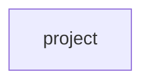

## Details

Static architecture map of 31 files (c, py, s, sh) in 1 components: project. Structure is extracted statically without LLM calls; component prose may be enriched locally.

### project (1)

project groups 31 files (c, py, s, sh) around CFG_MAX_SYMBOLS, CFG_MAX_FIXUPS, CFG_FIXUP_INIT, CFG_LINE_MAX, CFG_NAME_MAX. Autor: Gris Iscomeback Correo electrónico: grisiscomeback[at]gmail[dot]com Fecha de...

**Related Classes/Methods**:

- <a href="../ld.c">ld.c::CFG_MAX_SYMBOLS</a>
- <a href="../ld.c">ld.c::CFG_MAX_FIXUPS</a>
- <a href="../ld.c">ld.c::CFG_FIXUP_INIT</a>
- <a href="../ld.c">ld.c::CFG_LINE_MAX</a>
- <a href="../ld.c">ld.c::CFG_NAME_MAX</a>
- <a href="../ld.c">ld.c::CFG_MAX_NATS</a>
- <a href="../ld.c">ld.c::CFG_MAX_ERRORS</a>
- <a href="../ld.c#L32-L33">ld.c::CFG_GROW_UNIT</a>
