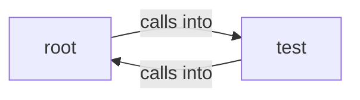

# project

project groups 31 files (c, py, s, sh) around CFG_MAX_SYMBOLS, CFG_MAX_FIXUPS, CFG_FIXUP_INIT, CFG_LINE_MAX, CFG_NAME_MAX. Autor: Gris Iscomeback Correo electrónico: grisiscomeback[at]gmail[dot]com Fecha de...

## root (1.1)

root groups 3 files (c, py, sh) around CFG_MAX_SYMBOLS, CFG_MAX_FIXUPS, CFG_FIXUP_INIT, CFG_LINE_MAX, CFG_NAME_MAX. Autor: Gris Iscomeback Correo electrónico: grisiscomeback[at]gmail[dot]com Fecha de...

## test (1.2)

test groups 28 files (c, s, sh) around write, main, main, _start, printf.

**Files**:

- app.py
- install.sh
- ld.c
- test/argv.c
- test/argv.s
- test/asm.c
- test/chain.c
- test/dynlib.c
- test/dynlib_host.c
- test/dynuse.c
- test/fib.s
- test/fib2.s
- test/fib3.s
- test/fmt.c
- test/fnptr.c
- test/globals.c
- test/hello.c
- test/loop.s
- test/movslq.s
- test/mutate.sh
- test/priv.s
- test/run_tests.sh
- test/start.s
- test/stdint.c
- test/sync.c
- test/t1.c
- test/t1.s
- test/udiv.c
- test/usestr.c
- test/w1.c
- test/w1.s
